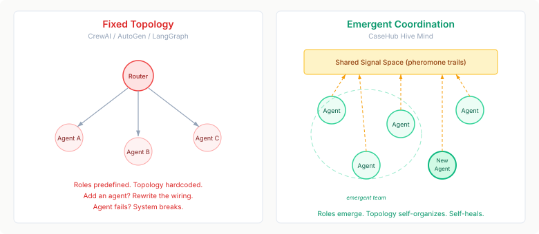
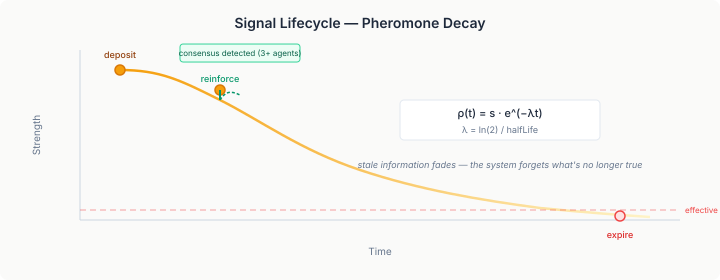
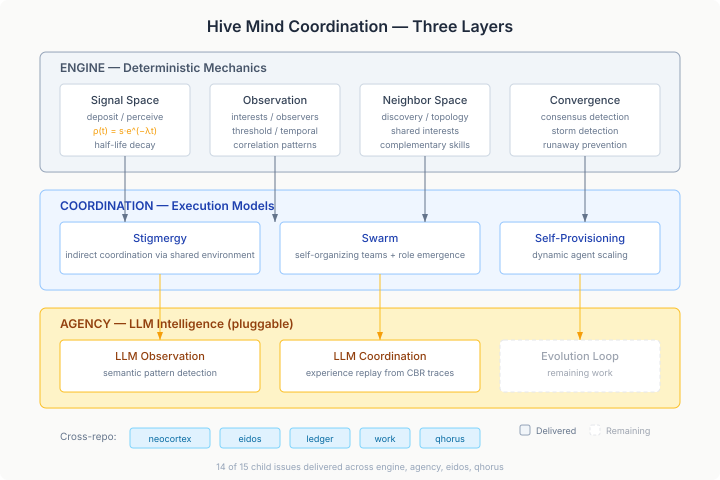

# Ants Don't Need a Manager

Every agent framework I've looked at — OpenAI Agents SDK, CrewAI, AutoGen, LangGraph — coordinates agents the same way: predefined roles, fixed workflows, handoff chains. Someone has to wire the topology before anything runs. The agents don't decide how to coordinate; the developer does.



Ant colonies don't work that way. Neither do immune systems, or flocking birds. The coordination emerges from local rules and shared environment — no central controller, no predefined roles. An ant doesn't know the colony's plan. It reads pheromone trails, follows simple rules, and the colony-level behaviour falls out.

That gap is real and it matters practically. A fixed topology is fine when you know the agents and the problem in advance. It falls apart the moment you need to add an agent, remove one that failed, or handle a problem shape you didn't anticipate. Every change requires rewiring the orchestration graph. The system is as rigid as its coordinator.

CaseHub's Hive Mind is the alternative made concrete for a case engine. And the foundation is now built across four repos.

## The Signal Primitive

The core abstraction is surprisingly simple: named signals with strength that decays over time.



An agent deposits a signal. Other agents perceive it. If multiple agents reinforce the same signal, consensus emerges without anyone counting votes. Crucially, signals decay using a half-life formula — `ρ(t) = s · e^(-λt)` — so stale information fades naturally.

This is the design decision that shapes everything else. The Emergent Collective Memory paper delivered the finding that drove it: environmental traces alone give zero benefit without decay. Without it, stale signals mislead future agents and the system converges on yesterday's answer. With it, the system forgets what's no longer true.

```java
public record PerceivedSignal(
    String name,
    double effectiveStrength,
    int reinforcementCount,
    String lastSource,
    Duration age) { }
```

An agent perceives signals, not raw data. It sees effective strength after decay, how many other agents reinforced this signal, and how old it is. That's enough to make local decisions without knowing what any other agent is doing.

## Stigmergy — Coordination Without Communication

Stigmergy sits on top of signals. The term comes from biology: insects coordinating through modifications to their shared environment rather than direct communication. No messages passed, no channels opened. The agent acts, the environment changes, other agents react to the change.

The `StigmergyCoordinator` watches for three emergent patterns: signal consensus (multiple agents converging on the same signal), coordination storms (activity rates spiking beyond safe thresholds), and interest convergence (many agents watching the same context keys). Each pattern is detected from the data, not declared in advance. The coordinator doesn't orchestrate — it observes and reports what's already happening.

## Swarm — Self-Organising Teams and Role Emergence

The swarm model goes further. Agents discover neighbours, form teams based on shared interests or complementary capabilities, and roles emerge from what agents actually do rather than what they were assigned.

A `RoleTracker` watches agent behaviour across four domains — perception, communication, decision, effect — and clusters agents by behavioural similarity. When a cluster stabilises, a role has emerged. A `TeamDetector` identifies working groups from shared interests and complementary capabilities using Jaccard similarity. None of this is declared. It's all observed.

The "Drop the Hierarchy and Roles" paper showed this beats predefined hierarchies by 14% — agents spontaneously creating 5,006 unique roles from just 8 starting agents. The practical implication: you don't need to design the team structure. You need to design the mission and the local rules. The structure follows.

## The Split That Makes It Work

One design constraint shaped everything: engine mechanics are deterministic; LLM intelligence is pluggable.



The rule-based hive mind works entirely in the engine with no AI dependency. Signal decay is arithmetic. Role clustering is cosine similarity. Convergence detection is threshold comparison. An LLM never touches these calculations.

Agency adds LLM-driven observation and coordination on top — semantic pattern detection that can interpret environmental state as natural language, experience replay from CBR plan traces, collective reasoning that synthesises observations from multiple swarm members. The engine never requires it. This mirrors the cognition/consequence split that SwarmWorld validated: deterministic execution with pluggable intelligence is more reliable than mixing the two.

It also means testing is tractable. The mechanical layer is fully deterministic and unit-testable. The LLM layer is independently testable against mocked engine state. No probabilistic behaviour leaks into the coordination mechanics.

## What This Actually Unlocks

The practical value isn't the biology metaphor. It's what you can build that you couldn't build before.

**Adaptive case handling.** A case starts with two agents. They deposit signals about what they're finding. A third agent, observing those signals, recognises a pattern neither of the first two saw. It joins, contributes, and when its work converges, it departs. No one rewired anything.

**Self-healing under failure.** An agent fails. Its signals decay. Neighbouring agents perceive the decay — the absence of reinforcement is itself information. They compensate through their local rules. The swarm provisioner detects the gap and spins up a replacement. No circuit breaker, no retry logic, no error handler. The system's normal operation handles failure.

**Continuous self-improvement.** The hive mind can introspect on its own performance, identify improvement opportunities, implement changes, and ship them through a review gate. The safety model is straightforward: all self-modifications go through devtown for review. If a change causes regression, the circuit breaker trips and the rollback template fires. Self-evolution with verification.

## The Gap That Remains

A cross-repo review revealed something worth being honest about: the two complete subsystems — engine's mechanical swarm and agency's LLM coordination — aren't production-wired to each other yet. Engine fires swarm events. Agency is ready to consume them. But the bridge adapter that connects them doesn't exist in production code.

The SPI boundary is clean and the contracts align. Both sides are independently tested. The integration is well-understood work, not design work. But until that bridge ships, the mechanical swarm and the LLM coordination layer operate in isolation.

The same gap exists for eidos (agent proximity queries built but unused by swarm code) and qhorus (broadcast channels built but unused by swarm coordination). The infrastructure is there. The wiring isn't.

That's next.
