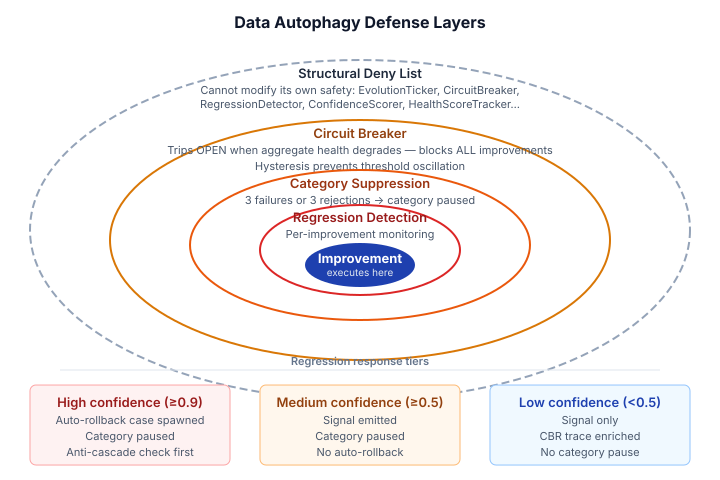
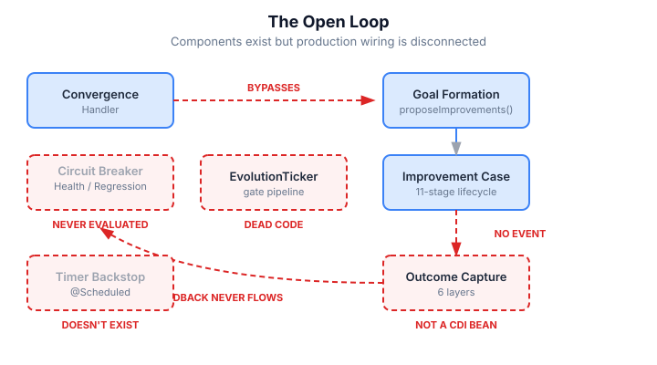
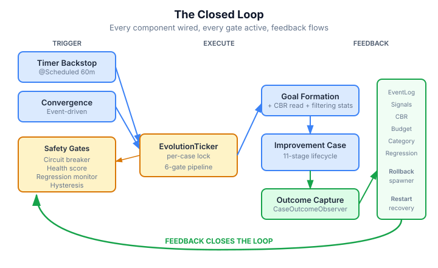

# The Loop That Wasn't

CaseHub's evolution subsystem is one of the most carefully designed pieces of the platform. Sixteen SPIs. Ten capability areas with landscape positioning and ROI computation. A research pipeline composing PRISMA, Technology Radar, and Wardley Mapping. A conductor inbox with three-layer escalation policy. A circuit breaker with event-sourced recovery. Regression detection with tiered confidence scoring. Anti-oscillation guards. Structural deny lists that prevent the system from modifying its own safety constraints.

All of it implemented. All of it tested. All of it passing.

None of it connected.

## What a self-improving system needs

The premise is simple. A system that can observe itself, identify where it's falling short, propose improvements, execute them through a quality gate, and learn from the outcomes. The research literature calls this a continuous evolution loop — and the key risk is "data autophagy," where self-improvement degrades quality without a verification gate to catch it.

The design addressed that risk with defence in depth. Four concentric safety layers protect the improvement from degrading the system it's trying to improve:

The structural deny list is the outermost guard: the improvement system literally cannot modify its own safety components. The circuit breaker trips when aggregate health degrades. Category suppression pauses any improvement direction that fails three times. And per-improvement regression monitoring watches health after each merge, with tiered responses proportional to confidence in causal attribution.

The architecture is sound. I'd go further — it's genuinely good design. The problem was elsewhere.

## The gap analysis

Claude and I ran a systematic audit — six parallel investigation agents, each checking a different aspect of the production code against the design spec. The question wasn't "do the classes exist?" The earlier exploration had already confirmed they did. The question was "are they wired together in the production CDI graph?"

The answer was stark.

`EvolutionTicker` — the single entry point for all improvement proposals, the component that runs the entire safety gate pipeline — was an orphaned CDI bean. Produced by `RuntimeBeans.java`. Consumed by nobody. The convergence detection handler was calling `proposeImprovements()` directly, bypassing every safety gate.

`ImprovementOutcomeEventCapture` — the six-layer outcome recording that feeds category tracking, regression detection, and the CBR learning loop — was not a CDI bean at all. The class existed with all six layers correctly wired internally. Nobody instantiated it. The `ImprovementCaseCompleted` event it was waiting for was never fired by anything.

The CBR projector that was supposed to store improvement outcomes for future learning? A logging stub. `LOG.debug("CBR projection for improvement outcome")` — that was the entire implementation.

Every individual component passed its tests because the tests created the objects directly and called methods on them. The unit tests proved the components worked. They did not prove the components were connected.

## The taxonomy of disconnection

Three types of gap, each with a different character:

**Dead wiring** — the component exists and is produced as a CDI bean, but nothing consumes it. `EvolutionTicker` is the canonical example. It sits in the CDI container, fully functional, waiting for a call that never comes. The convergence handler routes around it entirely.

**Missing lifecycle** — the component exists but is never created in the runtime graph. `ImprovementOutcomeEventCapture` has a constructor, fields, methods, tests — but no `@Produces` method, no `@ApplicationScoped` annotation (it's in the framework-agnostic `runtime-core` module, which correctly avoids CDI annotations), and no producer wiring it into the bean graph.

**Stub implementation** — the component exists, is wired, and is called — but does nothing. The CBR projector is the example. It occupies its slot in the six-layer capture pipeline. It receives the call. It logs and returns.

These three patterns are worth naming because they have different detection profiles. Dead wiring looks healthy in a dependency graph — the bean exists, it has no unsatisfied injection points. Missing lifecycle is invisible unless you diff what's produced against what the spec says should be produced. And stubs pass every interface contract check: they accept the right inputs and produce the right output types. They just don't do anything.

## What closing the loop actually requires

The design review caught something I hadn't accounted for: the engine's `runtime-core` module is framework-agnostic. No CDI annotations anywhere. All wiring goes through `RuntimeBeans.java` producer methods in the `runtime` module. And the existing improvement subsystem uses `Consumer<Event>` callbacks passed through constructors, not CDI `@ObservesAsync` observers.

That constraint shaped every wiring decision. The new `RollbackCaseSpawner` is a plain Java class in `runtime-core` that receives a `Consumer<RollbackRequested>` callback. The `EvolutionTimerBackstop` with its `@Scheduled` annotation lives in the `runtime` module, not `runtime-core`. `ImprovementOutcomeEventCapture` implements the existing `CaseOutcomeObserver` SPI instead of introducing a new CDI event type.

The trigger side was the simpler fix: route the convergence handler through `EvolutionTicker.tick()` instead of calling `proposeImprovements()` directly, and add a timer backstop. A per-case `ReentrantLock` prevents concurrent ticks from both paths racing.

The feedback side was more involved. `ImprovementOutcomeEventCapture` now implements `CaseOutcomeObserver` — the SPI that fires when any case reaches terminal state. It checks whether the completed case is an improvement case (by template ID) and routes through all six layers. No new event types needed; the existing lifecycle notification is sufficient.

The safety additions close gaps the original design specified but the implementation hadn't reached. `RegressionDetector` now fires a `RollbackRequested` callback when confidence exceeds the auto-revert threshold, and `RollbackCaseSpawner` creates the rollback case from the template — after checking for overlapping active improvements to prevent cascade failures. The circuit breaker gains hysteresis so it doesn't thrash between OPEN and CLOSED when health oscillates near the threshold. And startup recovery reconstructs three types of in-memory safety state from the EventLog: circuit breaker state, category pauses, and active regression monitors.

## The DevTown surface

DevTown is the first consumer of this infrastructure. It splits into two peer applications — DevTown:Review for day-to-day PR operations, and DevTown:Evolution for strategic improvement steering. One-way dependency: Evolution reads Review's data. Review doesn't know Evolution exists.

DevTown's evolution categories aren't code changes — they're operational tuning. Reviewer calibration. Routing adjustments. SLA thresholds. Gate strictness. Queue priority. Five capability areas assess health against these dimensions, and `DevtownProposalSource` generates improvement requests when any area drops below threshold.

The infrastructure exists: proposal source, five capability areas, conflict strategy, regression evaluator, category provider with custom stages (analyze → propose → review → apply → observe), full REST API, and two UI packages for the conductor workbench. What's missing are the workers that execute the "apply" stage — the components that actually adjust reviewer weights or modify routing rules. Those are next.

## What this means for self-improving systems

The gap analysis exposed a failure mode worth generalising. When you build a complex system with many components designed to work together, you can end up in a state where every piece is correct, every piece is tested, and the system as a whole does not function. The unit tests pass because they test components in isolation. The integration tests pass because they were written against the same isolated setup. Nothing tests whether the production wiring connects the pieces.

The fix isn't more testing — it's a different kind of testing. Integration tests that exercise the full CDI graph. Smoke tests that verify the ticker is actually invoked when context changes fire. A monitoring check that confirms outcome events are being captured. The components were built with care; the verification that they compose correctly in production was the gap.

For self-improving systems specifically, this gap is dangerous. A system that believes it can improve itself but silently cannot is worse than one that makes no such claim. The safety gates were designed to prevent data autophagy — but if those gates are never evaluated because the ticker is never called, the system is running without the safety net it thinks it has.

The loop is being closed. Eleven tasks across seven batches, each batch a safe wrap point. The implementation plan is committed and ready to execute.
