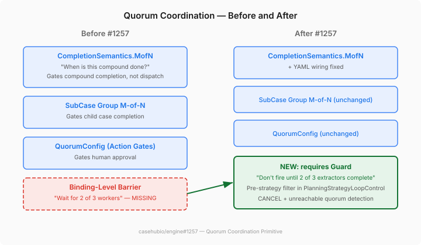
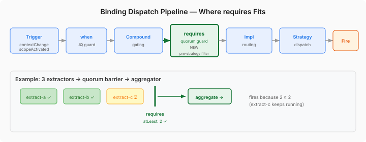

# Quorum: The Coordination Primitive Hiding in Plain Sight

I thought we already had quorum coordination. Turns out I was half right — and the half that was wrong is the interesting part.

The blocks-ui gallery has been rendering quorum barriers for months — those "wait for 2 of 3 agents" phase items in the `CoordinationPipeline`. The coordination-diff-view renders before/after overlays when quorum thresholds change. It looks real. But there's nothing backing it in the engine. The gallery fabricates the data.

When I picked up engine#1257 to close that gap, the first thing Claude and I did was audit what already existed. The assumption was straightforward: add a quorum primitive, wire it to the UI, done.

## Four Layers of Quorum That Already Existed

The audit surfaced M-of-N coordination at four distinct levels:

- **CompletionSemantics.MofN** on compounds — a sealed type variant that gates when a compound is *done*
- **SubCase group M-of-N** — `groupId`/`totalInGroup`/`requiredCount` for child case fan-out, used in production by casehub-life's family-vote pattern
- **QuorumConfig** on action gates — M-of-N multi-approver oversight for consequential worker actions
- **HumanTask quorum** — per-task approval gates via `YamlQuorumConfig`

The runtime for compound MofN works. `DefaultCasePlanModel.evaluateCompletion()` handles it correctly. The sealed interface is clean. Tests exist and pass across all three pathways — YAML, Java builder, annotations.

So the engine *does* have quorum. The issue's premise — "the engine has no equivalent" — was wrong. And yet the issue was right that something was missing.

## The Real Gap: Completion vs. Dispatch

`CompletionSemantics.MofN` answers one question: "when is this group of things done?" It doesn't answer a different question that looks similar but isn't: "when should the next thing fire?"



A compound with `completionSemantics: "2"` and three scoped bindings will mark itself complete when two of the three finish. That's the completion gate. But nothing in the compound model says "hold binding X from dispatching until N of these other bindings have completed." The compound doesn't control dispatch timing — that's the planning strategy's job.

Workers today either all run (choreography) or run one at a time (sequential). There is no "wait for N of M workers before firing the next one."

That's the actual gap. Not completion semantics — dispatch prerequisites. The distinction matters because it determines where the solution lives in the architecture.

## A Guard, Not a Trigger

The design question was where to put the barrier. Claude explored three options: a new trigger type (`quorumBarrier`), a binding property (`requires`), and named groups. I initially liked having both a trigger and a guard — the trigger for cases where the quorum IS the reason to fire, the guard for cases where it's additional gating on top of an existing trigger.

The design review pushed back hard on the trigger approach and it was the right call. All four existing trigger types — `contextChange`, `schedule`, `scopeActivated`, `cloudEvent` — respond to external events. A quorum barrier responds to internal plan model state. Putting it in the Trigger sealed interface would blur a distinction the platform keeps clean.

The result: `requires` as a binding-level guard, alongside `when`. It composes with any trigger type.

```yaml
bindings:
  - name: extract-a
    capability: extract
    on: { scopeActivated: {} }

  - name: extract-b
    capability: extract
    on: { scopeActivated: {} }

  - name: extract-c
    capability: extract
    on: { scopeActivated: {} }

  - name: aggregate
    capability: aggregate
    on: { scopeActivated: {} }
    requires:
      bindings: [extract-a, extract-b, extract-c]
      atLeast: 2
```

The `aggregate` binding's trigger fires on scope activation — same as the extractors. But `requires` holds it from dispatching until at least 2 of the 3 have completed. Clean separation: the trigger says *what* activates, the guard says *when* it's eligible.



The `requires` filter slots into `PlanningStrategyLoopControl.select()` after compound gating and before implementation routing. Bindings with unsatisfied prerequisites are filtered from the eligible set. When a referenced binding completes, the next planning cycle re-evaluates — no explicit notification needed, because worker completion already triggers a context change.

## A Silent Bug Along the Way

The audit also found that compound MofN from YAML was silently broken. `YamlCompound` has a `mofnRequired` field (via yaml-record-mappings), and `YamlCaseDefinitionConverter.convertCompound()` dutifully reads the YAML. Then it drops `mofnRequired` on the floor and passes only `completionSemantics` to the `CompoundDeclaration` constructor. The field existed, was parsed, and was ignored.

Worse: no `BlackboardPlanConfigurer` implementation existed to bridge YAML compounds into the runtime `PlanItemDefinition.Compound` model. The conversion chain was a dead end. You could declare a compound with `completionSemantics: "3"` in YAML, parse it successfully, and nothing would happen at runtime.

The programmatic path (Java builder, annotations) worked because tests construct `PlanItemDefinition.Compound` directly, bypassing the YAML converter entirely. The YAML path — the one most users would hit — was the broken one.

We fixed both: `convertCompound()` now resolves `mofnRequired` into the completion semantics string, and a new `CompoundBlackboardPlanConfigurer` registers YAML compounds into the plan model at case start.

## What Makes This Work

The design has three properties that matter:

**Composability.** `requires` is orthogonal to trigger type. A cron-triggered binding with `requires` is valid — "run this nightly aggregation, but only if the day's extractions have completed." Each cron tick re-evaluates the guard.

**Unreachable quorum detection.** If enough referenced bindings fault that the threshold becomes unreachable, the gated binding is proactively faulted. The formula follows `SubCaseGroupPolicy`: `remaining = total - completed - faulted`, `needed = required - completed`, `remaining < needed → FAULTED`. Without this, an unreachable quorum blocks forever.

**CANCEL semantics.** When the threshold is met and `onThresholdReached: CANCEL` is set, remaining in-flight referenced bindings are cancelled. The infrastructure already exists — `PlanItem.markCancelled()` is CAS-guarded, `SubCaseCompletionService.cancelPlanItemOnRejected()` demonstrates the pattern. Reuse, not reinvention.

## What's Left

The runtime quorum filter and compound fix are landed. Four tasks remain: the `RequiresThresholdEvaluator` (CDI event observer for CANCEL and unreachable quorum), annotation parity via `@Requires`, `CoordinationPipelineProjection` updates so blocks-ui can read real quorum data instead of fabricating it, and an end-to-end integration test.

The blocks-ui side — replacing fabricated quorum phases with engine-backed data — is the payoff that closes the loop. The `PhaseItemView` already has `required` and `of` fields waiting to be populated. Once the projection reads `Binding.getRequires()`, the gallery shows real coordination topology instead of a fiction.
