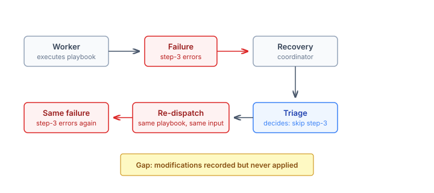
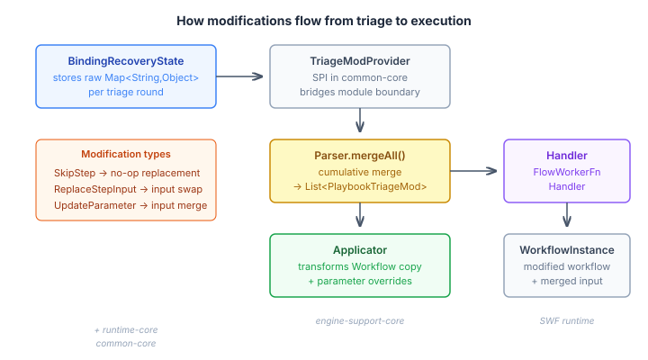
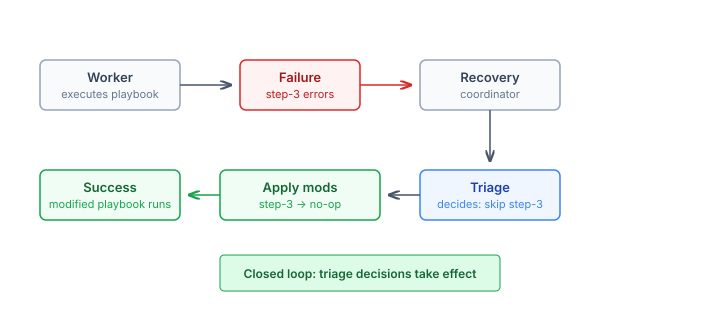

# Closing the triage loop — when recovery decisions actually take effect

CaseHub's recovery system has had three structural escalation levels for a while: transient retry, compound-level adaptation, and full case replan. Earlier this year we added a fourth path — triage — where a `TriageHandler` examines the failure, decides what to change, and triggers a retry with those modifications recorded. The handler could say "skip step-3" or "replace the input for the fetch step" or "set the timeout parameter to 30 seconds."

The architecture was clean. The decision was recorded. The retry was dispatched.

And then the worker ran the identical playbook with the identical input and produced the identical failure.

## The gap

The triage infrastructure landed in #1262. It introduced `PlaybookTriageModification` — a sealed hierarchy of `SkipStep`, `ReplaceStepInput`, and `UpdateParameter`. It built `PlaybookTriageModificationParser` to convert the raw modification maps into typed objects. And it wired `DefaultRecoveryCoordinator.attemptTriage()` to record modifications in `BindingRecoveryState` and publish a `CaseContextChangedEvent` to re-dispatch the worker.

What it didn't do was read those modifications back and apply them before re-execution. The event re-dispatched the worker. The worker's handler — `FlowWorkerFunctionHandler` — created a workflow instance from the same compiled `Workflow` object, passed the same input map, and started execution. The triage handler's decision evaporated at the boundary between "decide what to change" and "execute the changed thing."



This is the kind of gap that's easy to miss in a modular system. The recovery coordinator and the worker handler live in different modules. The coordinator records modifications; the handler executes workflows. Nobody owns the connection point.

## Where to apply modifications

The design question was where in the execution pipeline to inject the changes. Three options:

**Re-compile from modified YAML.** Store the original playbook content, apply modifications as YAML transformations, re-compile through `PlaybookCompiler`. Clean in theory — you always get a validated compilation result. But it requires storing the original YAML (currently discarded after compilation), introduces a re-compilation cost on every retry, and the step IDs used by the triage handler are SWF task names, not YAML step names — so you need a reverse mapping through the `SourceMap`. Cross-repo change.

**Thread modifications through `ExecutionMetadata`.** The orchestrator resolves modifications and passes them as data alongside the worker name and binding name. The handler receives them without needing its own SPI dependency. But `ExecutionMetadata` is a cross-cutting type shared by every handler — MCP, ReAct, A2A — and triage modifications are a playbook-specific concept. Polluting a shared type with domain data is a design smell.

**Apply at the handler level with an SPI for state lookup.** The handler already knows it's executing a `PlaybookWorkerFunction`. It already has `metadata.bindingName()` and `context.caseId()`. A thin SPI — `TriageModificationProvider` — lets it query for modifications without depending on the recovery state registry directly. The handler creates a modified copy of the workflow, merges parameter overrides into the input, and executes the modified version.

We went with the third option. The handler is the natural place — it's where playbook-specific logic already lives, and it's the last point before the workflow instance is created.

## How it works



The pipeline has four components:

**`TriageModificationProvider`** is an SPI interface in `common-core`. One method: `getModifications(caseId, bindingName)` returns the raw modification maps from `BindingRecoveryState`. The default implementation in `runtime-core` is five lines — it looks up the binding state and returns what's there. The SPI exists purely to bridge the module boundary between `engine-support-core` (where the handler lives) and `runtime-core` (where the recovery state lives).

**`PlaybookTriageModificationParser.mergeAll()`** takes the list of per-round modification maps and produces a single merged list. Modifications accumulate across triage rounds — if round 1 skips step A and round 2 skips step B, both are skipped on the next attempt. For `ReplaceStepInput` and `UpdateParameter`, later rounds override earlier ones per step ID or parameter key. This gives the triage handler flexibility to layer corrections without repeating everything from prior rounds.

**`PlaybookTriageModificationApplicator`** transforms a compiled SWF `Workflow` into a modified copy. `SkipStep` replaces the target `TaskItem` with a no-op `SetTask` — the step name survives (so the flow's position structure is preserved) but the original logic is gone. `ReplaceStepInput` wraps the target step in a `DoTask` block with an input injection. `UpdateParameter` collects overrides for the workflow input map. The applicator traverses recursively — it handles steps nested inside `DoTask`, `TryTask`, `ForTask`, and `ForkTask` containers, which is the full set of nesting structures the playbook compiler produces.

The original workflow is never mutated. A new `Workflow` object is constructed from the modified task list. This matters because `PlaybookWorkerFunction` instances may be shared across concurrent executions.

**`FlowWorkerFunctionHandler`** ties it together. In `execute()`, between extracting the input map and creating the workflow instance:

```java
if (swf instanceof PlaybookWorkerFunction
    && triageModProvider != null
    && triageModProvider.isResolvable()
    && metadata.bindingName() != null) {
  List<Map<String, Object>> rawMods =
      triageModProvider.get().getModifications(
          context.caseId(), metadata.bindingName());
  if (!rawMods.isEmpty()) {
    List<PlaybookTriageModification> merged =
        PlaybookTriageModificationParser.mergeAll(rawMods);
    ModificationResult modResult =
        PlaybookTriageModificationApplicator.apply(
            effectiveWorkflow, merged);
    effectiveWorkflow = modResult.workflow();
    // ... merge parameter overrides into input
  }
}
```

The guard is deliberate. Only `PlaybookWorkerFunction` — not `FlowWorkerFunction`, not MCP, not ReAct, not A2A. Only when a provider is on the classpath. Only when the binding name is known. Every other execution path is completely untouched.



## Why this matters

The recovery system's value proposition is that a case engine can respond to failures with intelligence, not just retries. The structural levels — agent exclusion, compound adaptation, full replan — change the plan. Triage changes the execution within the plan. A playbook step that fails because it's calling an endpoint that's down can be skipped. A step that fails because its input data is stale can have its input replaced. A parameter that's too aggressive can be softened.

Without the application loop, triage was a decision without consequences. The handler had the information it needed to know what to change — it just didn't read it. Now it does, and the recovery system can express "try this differently" instead of just "try this again."

The cumulative semantics are worth calling out. Each triage round adds to the modification set rather than replacing it. Round 1 might skip a validation step. Round 2, seeing a different failure on the retry, might also replace the input for a fetch step. Round 3 gets both the skip and the replacement. The triage handler doesn't need to remember and re-specify everything from prior rounds — it describes what's new. The engine accumulates.

This is the last piece before the triage loop is operational end-to-end. Once a `TriageHandler` implementation lands in platform (casehubio/platform#668), a case definition author can plug in domain-specific triage logic and have it actually take effect on re-execution. The engine side is ready.
