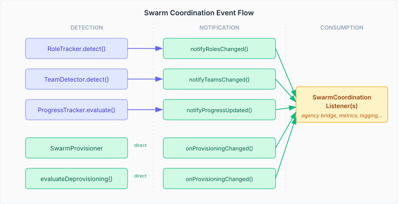
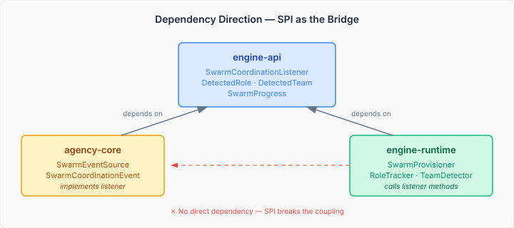

# Why Your Swarm Needs a Nervous System

A swarm without coordination events is a swarm that can't learn. CaseHub's engine has had swarm provisioning, role detection, and team formation for a while now — agents join, cluster into behavioural roles, form teams around shared interests, and the progress tracker watches for convergence. All of this works. But none of it was visible to the agency layer that actually orchestrates the agents' conversations.

The engine detects that roles shifted. Agency never hears about it. The engine provisions a third agent. Agency doesn't know the team grew. Progress crosses a convergence threshold. Agency keeps prompting as if nothing changed.

This is a coordination gap, and it matters more than it sounds.

## What coordination events actually are

Every stigmergy cycle, the engine runs a detection pipeline. RoleTracker clusters agents by behavioural fingerprint — who's reading what, who's writing what, who fires which rules. TeamDetector finds groups with high shared-interest affinity. SwarmProgressTracker computes three scores: exploration pace, consensus, and stability. SwarmProvisioner decides whether to grow or shrink the swarm based on signal consensus and budget constraints.

Each of these produces internal `SwarmEvent` records. Until now, those records went to a debug log and disappeared. The agency layer — which builds prompts, routes decisions, manages the conversation flow — had no way to react to any of it.



The fix is a listener SPI: `SwarmCoordinationListener`. Six methods, all with default no-ops, covering the full lifecycle:

```java
public interface SwarmCoordinationListener {
  default void onSwarmInitialised(UUID caseId, SwarmProgress progress) {}
  default void onRoleChanged(UUID caseId, List<DetectedRole> roles, SwarmProgress progress) {}
  default void onTeamChanged(UUID caseId, List<DetectedTeam> teams, SwarmProgress progress) {}
  default void onProgressUpdated(UUID caseId, SwarmProgress progress) {}
  default void onMemberCompleted(UUID caseId, String agentId) {}
  default void onProvisioningChanged(UUID caseId, int currentSize, int maxSize) {}
}
```

Default no-ops mean an implementation only overrides what it cares about. Agency bridges role and team changes into its own `SwarmCoordinationEvent` sealed interface. A metrics listener counts provisioning events. A test listener records everything. They all coexist — this is a multi-instance SPI by design.

## The dependency direction problem

This is where the design gets interesting. Agency depends on engine-api. Engine-runtime depends on engine-api. Agency and engine-runtime don't depend on each other. They can't — that would create a cycle.



Agency already has a `SwarmCoordinationEvent` sealed interface with exactly the event types we need — `RoleChanged`, `TeamChanged`, `ProgressUpdated`, and so on. The tempting move: put that sealed interface in engine-api and use it as the SPI's event type.

I rejected this. The sealed interface belongs to agency — it's their domain model for how swarm events map to driver events and context updates. Engine shouldn't know or care about that mapping. Instead, the SPI uses method-per-event with types already in engine-api: `DetectedRole`, `DetectedTeam`, `SwarmProgress`. Agency writes a thin bridge that maps each callback to its own event type. The boundary stays clean.

This follows the existing pattern. `WorkerStatusListener` has `onWorkerStarted`, `onWorkerCompleted`, `onWorkerStalled` — specific typed methods, not a generic event object. The same discipline applies here.

## Where the events come from

Not everything originates in one place. Role detection, team detection, progress tracking, and provisioning are separate components with separate lifecycles. But the issue asked for a single coordination point, and SwarmProvisioner is the right one — it's the swarm lifecycle owner, it already holds references to all the trackers, and it manages the provisioning events directly.

The split works like this: SwarmProvisioner emits `onSwarmInitialised` and `onProvisioningChanged` from its own methods. For role, team, and progress changes, it exposes `notifyRolesChanged()`, `notifyTeamsChanged()`, and `notifyProgressUpdated()` — the convergence detection handler calls these after each detection phase when the results are non-empty.

One subtlety: `onSwarmInitialised` fires once per case, on the first successful provision. Not on the first evaluation cycle, not on the first budget check — on the moment the swarm actually has a new member. A `Set<UUID>` tracks which cases have emitted their init event. It's cleared on `evictByCase()` and `reset()`, so a case that restarts gets a fresh init.

## Why this matters for swarm intelligence

A swarm that can't communicate its internal state to its coordination layer is a swarm running on inference and guesswork. Agency's `SwarmEventSource` exists specifically to update `SwarmContext` — the state object that informs prompt construction, routing decisions, and termination logic. Without lifecycle events flowing in, SwarmContext is always stale. Prompts don't reflect the current role structure. Routing doesn't know the team composition. The convergence check can't see that stability has been achieved.

With the listener in place, agency can react in real time. Roles shift — agency adjusts the prompt sections that describe team structure. A new agent is provisioned — agency updates the routing strategy with the new capacity. Progress crosses the stability threshold — agency can trigger convergence without waiting for the next polling cycle.

The multi-instance design is deliberate. The `no-defaultbean-multi-instance-spi` protocol exists because Quarkus Arc's `@DefaultBean` suppresses all defaults when any non-default bean of the same type is registered. For an SPI where multiple listeners coexist — agency's bridge, a metrics exporter, a test recorder — `@DefaultBean` would silently drop all but one. Plain `@ApplicationScoped` implementations collected via `Instance<SwarmCoordinationListener>` avoid this entirely.

The agency-side bridge is the next piece. That's a separate repo, a separate concern. The engine's job is to emit the events reliably and let consumers decide what to do with them.
