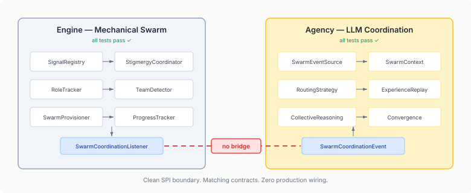

# The Bridge Nobody Built

We closed the Hive Mind epic this week. Fifteen child issues across four repos, all verified against committed code on main. Every component has tests. Every test passes. The architecture is clean — engine provides the deterministic swarm mechanics, agency provides the LLM coordination layer, eidos provides agent discovery, qhorus provides broadcast channels.

Then we ran a cross-repo wiring review and found that the two main subsystems have never exchanged a single event in production.

Engine fires 21 swarm event types — role emergence, team formation, progress updates, provisioning decisions, convergence detection. Agency has a `SwarmEventSource` ready to receive all of them, a sealed hierarchy of `SwarmCoordinationEvent` variants matching every engine callback, and an LLM coordination pipeline that processes those events into routing decisions, experience replay, and collective reasoning.

The SPI boundary is textbook. `SwarmCoordinationListener` defines five lifecycle methods. Agency's event types map one-to-one. The shared domain records (`DetectedRole`, `DetectedTeam`, `SwarmProgress`) are imported directly from engine-api — no local duplicates, no translation layer needed.

But nobody wrote the adapter class that implements the listener and delegates to the event source. Forty lines of code, give or take. Both sides built to the contract. Neither side built the bridge.

## How This Happens

It's not a mistake anyone made. It's a failure mode inherent to multi-repo development with SPI boundaries.

Each repo has its own test suite. Engine tests the mechanical swarm against mock listeners. Agency tests the LLM coordination against manually injected events. Both sides are independently correct. Both sides are independently complete. The CI for each repo is green.

The integration gap lives in the space between repos — and nothing in the standard development loop catches it. No single repo's test suite can detect that the other repo's consumer doesn't exist yet. The SPI contract is satisfied on both sides in isolation. The fact that no production class implements the interface is invisible until someone traces the full path from producer to consumer across repo boundaries.

This is the same pattern that causes microservice integration failures in production. Each service passes its contract tests. The system fails when they talk to each other because nobody tested the actual conversation.

## What the Review Found

The swarm bridge was the critical gap, but not the only one:

**Eidos built proximity queries that nobody calls.** `AgentQuery.byProximity()` finds agents with similar capabilities. `RuntimeCollaborationQuery.collaborators()` returns the collaboration graph around an agent. Both are fully implemented, tested, and documented. Neither is referenced from any swarm code in engine or agency. The discovery infrastructure exists; the swarm doesn't use it.

**Qhorus built broadcast channels that nobody sends to.** `MessageDispatcher.broadcast()` sends to all agents observing a capability. `BroadcastMembershipManager` auto-enrolls agents based on their registered capabilities. The coordination infrastructure exists; the swarm doesn't use it.

**Engine and eidos independently defined the same enum.** `NeighborRelation` in engine-api and `CollaborationRelation` in eidos-api — same four values (COACTIVE, SHARED_INTEREST, SHARED_SIGNAL, COMPLEMENTARY), different types. If any code ever needs to pass data between them, someone will write a mapping function and wonder why two identical enums exist.

Each of these is straightforward to fix. None requires design work — the contracts are already aligned. The question is why they weren't caught during the two months of development.

## The Structural Problem

SPI-based architecture is good at preventing coupling. It's bad at detecting missing integration. The same indirection that lets two repos evolve independently also lets them drift apart without any signal that they're drifting.

Unit tests test components. Integration tests test connections. Multi-repo SPI boundaries create a third category: connections that should exist but don't. No test fails when a listener has zero implementations. No linter catches an SPI with no consumer. The absence of wiring is invisible to every tool in the standard development loop.

What would catch it? A cross-repo integration test that boots engine and agency together and verifies that a signal deposit eventually reaches the LLM coordination pipeline. Or a static analysis that scans all repos for SPI interfaces with zero production implementations. Or — what actually caught it — a human reading the code across all four repos and tracing the data flow from end to end.

## The Practical Fix

The bridge adapter is now landed (agency#375). The remaining work is wiring eidos and qhorus into the swarm lifecycle — feeding proximity data into provisioning decisions, broadcasting coordination events to swarm members. All mechanical, all contract-aligned.

The more lasting fix is making these gaps structurally detectable. When an SPI interface has implementations only in test code, that should show up somewhere. When a repo builds infrastructure that no sibling repo consumes, that's worth flagging. Not as an error — optional infrastructure is fine — but as information. "This SPI has zero production consumers across all repos" is a useful thing to know before you close an epic and call it done.

We didn't have that this time. We had a review. The review found the gap in an afternoon. But the gap had been open for two months, hidden behind green CI and passing tests on every individual repo.

The bridge was forty lines of code. Finding that it was missing took considerably longer.
