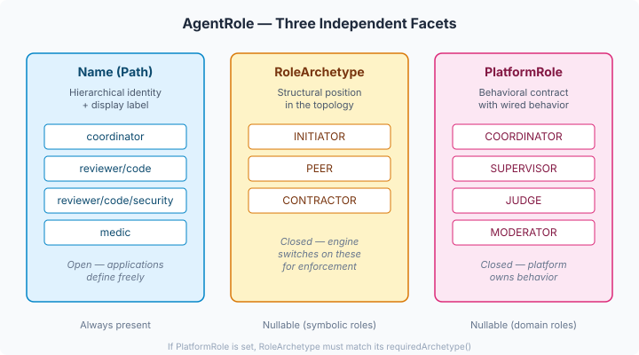
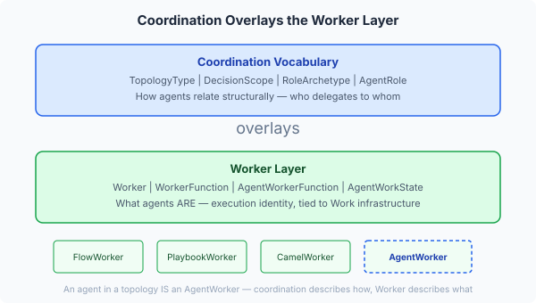

# The Vocabulary That Shapes Everything

When you build a platform for multi-agent coordination, the vocabulary comes first. Not the SPIs. Not the enforcement logic. Not the topology provider. The names you give things — the enums, the records, the relationships between them — shape every downstream decision for every consumer. Get the vocabulary wrong and you'll be renaming, migrating, and apologising for years.

We spent a full session on six types. Six. And every one of them had a landmine.

## Why vocabulary types are not "just enums"

A naive view: `TopologyType` is an enum with three values, `DecisionScope` is an enum with three values, done in ten minutes. The reality: each value carries mechanical enforcement semantics. The engine will `switch` on these. The capability guard will deny actions based on them. Agency will configure LLM reasoning around them. YAML authors will declare them in case definitions. If the name is wrong, the semantic mismatch propagates through every layer.

Take `DecisionScope`. The original spec had `REACTIVE` as the first value — an agent that responds to incoming signals only. Reasonable name. But the platform already has `MeshParticipation.REACTIVE` in `spi.mesh` — meaning "do not register in the mesh; only engage when directly addressed." Both live under `io.casehub.api`. Both would be static-imported in the same files. Same word, different concept, guaranteed confusion. We renamed it `STIMULUS_DRIVEN` — which is actually more precise about what the scope means.

That's the kind of thing that takes five minutes to find and saves five months of "wait, which REACTIVE?"

## The three-faceted role model

The interesting design problem was `AgentRole`. The issue spec said: "put these types in engine-api." Simple enough for enums. But what is a "role" in a coordination topology? We went through four naming iterations, an adversarial design review, a literature survey across FIPA, the Moore HMAS taxonomy, Google's A2A protocol, LangGraph, CrewAI, and half a dozen academic papers — and landed on a model with three independent facets.



**Name** — a hierarchical `Path`, open and application-defined. `reviewer/code`, `reviewer/prose`, `medic`, whatever the domain needs. Hierarchy matching via `isKindOf()` lets you ask "is this agent a reviewer of any kind?" without enumerating subtypes.

**StructuralRole** — structural position in the topology. Three values: `INITIATOR` (delegates to others), `PEER` (equal-status coordination), `CONTRACTOR` (receives delegation). Closed enum — the engine switches on these.

**PlatformRole** — behavioral contract the platform implements. `COORDINATOR`, `SUPERVISOR`, `JUDGE`, `MODERATOR`. Each carries a `requiredStructuralRole()` that the compact constructor enforces — you cannot create a COORDINATOR with CONTRACTOR structural role.

The three facets are independent. A platform role implies a structural role, but not vice versa. A symbolic role (just a label for rendering) has name only — null structural role, null platform role. The compact constructor enforces the invariants:

```java
public AgentRole {
    Objects.requireNonNull(name, "name must not be null");
    if (platformRole != null && structuralRole == null) {
      throw new IllegalArgumentException(
          "platformRole requires structuralRole");
    }
    if (platformRole != null && structuralRole != platformRole.requiredStructuralRole()) {
      throw new IllegalArgumentException(
          platformRole + " requires " + platformRole.requiredStructuralRole());
    }
}
```

The code is six lines. The reasoning behind it took hours.

## The naming that nearly went wrong three times

FIPA's Contract Net Protocol calls the third structural role "Participant." We couldn't use that — the platform already has `Participation.PARTICIPANT` (compound completion semantics, 129+ references). So we searched for the modern consensus.

Every major agentic framework — LangGraph, Microsoft Agent Framework, Kubernetes — calls it "Worker." Clean, unambiguous, widely understood. We almost went with it. Then the obvious landed: CaseHub already has Worker as a first-class concept hierarchy. `Worker` → `FlowWorker`, `PlaybookWorker`, `CamelWorker`, `AgentWorkerFunction`. An agent in a coordination topology IS an AgentWorker at the execution layer. Using `StructuralRole.WORKER` would conflate the coordination relationship with the execution identity.



We went with `CONTRACTOR` — the FIPA origin term from Smith's 1980 Contract Net Protocol. Same register as `INITIATOR`. No platform collision. It describes the coordination contract ("bids on and executes announced tasks"), not the execution identity ("is a worker").

The deeper insight: coordination vocabulary overlays the Worker layer. It describes *how agents relate structurally* — who delegates to whom. The Worker layer describes *what they are* — the execution primitive tied to WorkItems, WorkerFunctions, and the Work infrastructure. These are two different questions, and the vocabulary must not conflate them.

## What the review found that I missed

The adversarial review ran four dimensions (coherence, structure, robustness, cross-cutting) and caught real problems. `GRADUATED` was removed from `TopologyType` — it describes how the topology changes, not what it is. `DecisionAuthority` was removed entirely — it's derivable from `TopologyType` x `StructuralRole` as a total function, and storing it separately creates stale-data risk. `TopologyDescriptor` was deferred out — it's runtime state, not vocabulary, and belongs with the SPIs that construct it.

But the review also missed something. It caught naming collisions with sibling types — horizontal scanning, same package level. It did not catch that the spec was modelling "the agent that receives and executes delegated work" as a new concept when the platform already owns that concept at a different abstraction layer. That gap only surfaced when I recognised the Worker hierarchy. Coherence reviews need to zoom out to platform-level concept maps, not just immediate neighbours.

## What this opens up

Six types. A coordination vocabulary that both engine and agency share. Every downstream issue — the capability guard, the topology provider, the convergence evaluator, the telemetry layer — now has a shared language. The `AgentCapabilityGuard` switches on `DecisionScope` and `DecisionType` against a static permission matrix — a compiler-enforced total function where adding a new action category breaks the build until every scope handles it. When #1284 builds `TopologyProvider`, it creates `TopologyDescriptor` records using `TopologyType` and `AgentRole`. No ambiguity about what "coordinator" means, because `PlatformRole.COORDINATOR` has a `requiredArchetype()` of `INITIATOR` and the constructor won't let you create a contradictory one.

The five-dimension coordination model from the parent epic now has three dimensions with engine types (topology, scope, roles) and two more tracked as issues (communication mode, observation strategy). The PlatformRole behavioral SPIs — coordinator, judge, moderator — each have their own issue under a new epic. Nothing is floating unnamed in someone's head.

That's the job of vocabulary work. Not writing enums. Making sure every concept has exactly one name, every name has exactly one meaning, and every relationship between names is explicit and enforced. The code is trivial. The naming is the architecture.
