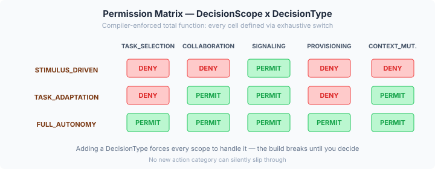
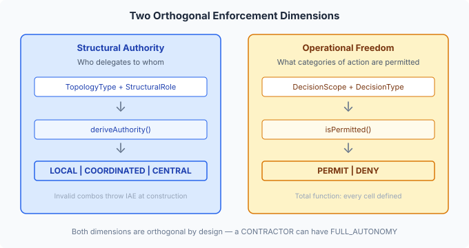

# From Vocabulary to Enforcement

Vocabulary without enforcement is just documentation. You can define `DecisionScope.STIMULUS_DRIVEN` all you like — if nothing prevents a STIMULUS_DRIVEN agent from selecting its own tasks, the enum is a comment with syntax highlighting.

The gap between "this type exists" and "the engine acts on it" is where most multi-agent frameworks go wrong. They define roles, scopes, and topologies in config files, then leave enforcement to convention: the LLM prompt says "you are a subordinate, do not initiate." That's the coordination equivalent of security by obscurity. An LLM that hallucinates past its scope boundary won't be stopped by a system prompt. The enforcement has to be mechanical — the platform checks before the action happens, not after.

## The permission matrix as a compiler contract

The reference matrix from the vocabulary spec defines fifteen cells: three scopes times five action types. Every cell is either PERMIT or DENY. No gaps. No "it depends." A total function.



The interesting design question was how to encode it. A lookup table works but fails silently when someone adds a sixth `DecisionType`. The matrix stays 3x5 while the enum grows to six values, and the new action category is implicitly permitted everywhere — the worst possible default for a security-relevant function.

We encoded it as exhaustive switch expressions on the enum itself:

```java
TASK_ADAPTATION {
  @Override
  public boolean isPermitted(DecisionType type) {
    return switch (type) {
      case COLLABORATION, SIGNALING, CONTEXT_MUTATION -> true;
      case TASK_SELECTION, PROVISIONING -> false;
    };
  }
}
```

The `switch` is exhaustive over the `DecisionType` enum. Add a value — say, `ESCALATION` — and every `DecisionScope` override fails to compile. The build breaks before the tests run. You cannot ship a new action category without explicitly deciding, for every scope, whether it's permitted.

This is compiler-driven enforcement design. The matrix isn't documented somewhere and checked by tests. It's a structural property of the code that the compiler verifies on every build. The total-function invariant isn't a spec requirement — it's a compilation requirement.

## Two enforcement dimensions, orthogonal by design

The capability guard enforces *operational freedom* — what categories of action an agent may perform. But there's a second dimension: *structural authority* — who delegates to whom within the topology.



Structural authority is derived, not configured. A `CENTRALISED` topology with an `INITIATOR` role produces `CENTRAL` authority. A `DISTRIBUTED` topology with a `PEER` role produces `COORDINATED` authority. Some combinations are structurally incoherent — a `PEER` in a `CENTRALISED` topology is a contradiction, because centralised by definition has a coordinator/subordinate structure. Those throw `IllegalArgumentException` at construction time, not at action time.

The two dimensions are deliberately orthogonal. A `CONTRACTOR` (structurally subordinate — receives delegation) can have `FULL_AUTONOMY` (operationally free — decides sub-tasks, collaborations, timing). The coordinator decides *what* is delegated; the contractor decides *how* to do it. This is a real pattern in multi-agent systems: specialised agents that need complete freedom within their area of expertise, while remaining structurally subordinate to the coordination topology.

Conflating these would force a false choice — either the agent has authority and autonomy, or it has neither. Real coordination doesn't work that way.

## Why the guard returns a decision, not a boolean

Early in the design, the guard returned `boolean`. Simple, clean, follows the `WorkerExecutionGuard` precedent. But a caller that gets `false` has no information about *why*. The guard is the only component that knows the agent's scope and the failing matrix cell. Making every caller separately look up the agent's scope to produce a log message is redundant computation and couples callers to enforcement internals.

The existing `ActionRiskClassifier` already solved this — it returns `RiskDecision`, a sealed interface carrying the classification context. We followed the same pattern:

```java
public sealed interface GuardDecision {
  record Permitted() implements GuardDecision {}
  record Denied(DecisionScope agentScope, DecisionType attemptedType)
      implements GuardDecision {}
}
```

A `Denied` result carries exactly what the caller needs for structured logging — the scope that blocked the action and the action type that was attempted. No second lookup. No coupling to guard internals. The pattern match at the call site is three lines.

## Naming across a platform

While building the guard, we discovered a naming collision. The vocabulary had `RoleArchetype` for INITIATOR/PEER/CONTRACTOR. Eidos — the agent identity layer — already owns "archetype" heavily: `ArchetypeTerm` (48 personality archetypes from the Hartwell & Chen model), `ArchetypeFamily` (12 motivation quadrants), `AgentDescriptor.archetype`. All about who the agent *is* — personality, capability profile. Coordination's INITIATOR/PEER/CONTRACTOR describe where the agent *sits* — structural position within a topology. Same word, different concept.

We renamed it `StructuralRole`. Not because the two would collide at the type level — they're in different packages — but because the shared word creates conceptual confusion when both appear in the same design conversation. And they will. The moment someone configures an agent's coordination role alongside its personality archetype, the ambiguity costs time.

The deeper insight: INITIATOR/PEER/CONTRACTOR aren't just positioned within structure — they *are* the structural primitives that define topology shape. A centralised topology is centralised *because* it has one INITIATOR and CONTRACTORs. A distributed topology is distributed *because* it has PEERs. `StructuralRole` captures this correctly. They are the foundation layer; everything else specialises on top.

## What this makes possible

The engine now has a complete enforcement vocabulary — types that the compiler verifies, a guard SPI that any consumer can implement, and a NoOp default that preserves backward compatibility. When agency ships a scope-aware guard implementation, every agent action goes through a mechanical check before execution. No prompt engineering. No convention. No hoping the LLM respects its boundaries.

The next piece is the topology descriptor — the runtime state that says "this is a CENTRALISED topology, agent X has INITIATOR role with TASK_ADAPTATION scope." That's where the guard gets its data. Without it, the guard has nothing to look up. With it, every integration point — signal deposit, message send, task selection, provisioning, context mutation — becomes a gated operation.

Mechanical enforcement is not glamorous work. It doesn't produce demos or move metrics. But it's the difference between a platform where agents *cannot* exceed their scope and one where they merely *shouldn't*.
