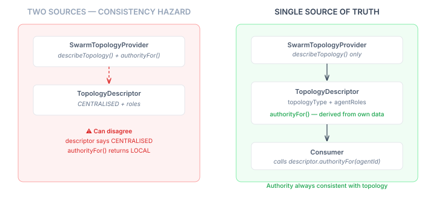
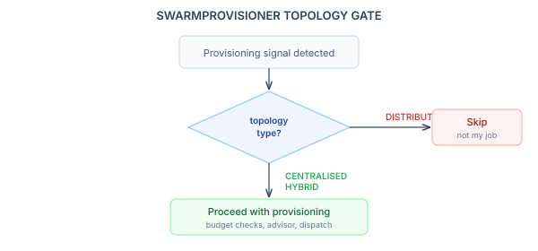

# The Single Source of Truth Problem in Multi-Agent Authority

Continued from [From Vocabulary to Enforcement](2026-11-02-mdp01-from-vocabulary-to-enforcement.md).

The vocabulary named things. The guard enforces rules. But both are useless without a runtime answer to a deceptively simple question: *who has authority here?*

In a centralised topology, the coordinator has central authority. In a distributed topology, peers have coordinated authority. In a hybrid, it depends on your structural role. The question isn't complicated — it's a lookup in a 3x3 matrix that `TopologyType.deriveAuthority(StructuralRole)` already computes. The design problem is where that lookup lives, and the wrong answer creates a class of bug that testing won't catch.

## The consistency hazard

The issue spec proposed two methods on the topology provider SPI: `describeTopology()` returns the topology state, `authorityFor()` returns the authority for a given agent and decision type. Two methods, each returning useful data. Seems clean.

It's not. The problem is that nothing structurally prevents the two methods from disagreeing:

```java
// Provider returns CENTRALISED...
descriptor.topologyType() == TopologyType.CENTRALISED

// ...but says this agent has LOCAL authority
provider.authorityFor(caseId, agentId, PROVISIONING) == LOCAL
```

The descriptor says one thing. The authority function says another. The consumer gets two different answers about the same topology from the same provider. This isn't a theoretical concern — it's the natural consequence of putting the same fact in two places. Every time you duplicate the source of truth, you create a maintenance surface where the copies can diverge. Tests won't catch it because each method individually returns valid values. The bug is the relationship between them.



## Data types should not make policy decisions — but derivation isn't policy

The initial reaction against putting `authorityFor` on `TopologyDescriptor` was principled: records should be inert data carriers. Policy belongs on the types that consume them, not on the data itself. If authority involves judgment — case-specific overrides, per-decision-type nuance, external state — it belongs on the SPI, not the record.

But authority derivation isn't policy. It's arithmetic on the record's own fields. The descriptor carries the topology type and the agent-role map. Authority is `topologyType.deriveAuthority(role.structuralRole())` — a function of data the descriptor already holds. No external state. No case-specific logic. No judgment. A derivation method on a record isn't policy; it's a convenience that makes the record's semantics explicit.

The SPI's job is to *describe* the topology — to answer "what does the coordination structure look like for this case?" That's `describeTopology()`. One method. The authority question is answered by the data it returns.

```java
public interface SwarmTopologyProvider {
    TopologyDescriptor describeTopology(UUID caseId);
}
```

The descriptor answers everything else:

```java
public record TopologyDescriptor(
    TopologyType topologyType,
    Map<String, AgentRole> agentRoles) {

  public DecisionAuthority authorityFor(String agentId) {
    AgentRole role = agentRoles.get(agentId);
    // ... null checks ...
    return topologyType.deriveAuthority(role.structuralRole());
  }

  public Optional<String> coordinatorAgentId() {
    return agentRoles.entrySet().stream()
        .filter(e -> e.getValue().structuralRole() == StructuralRole.INITIATOR)
        .map(Map.Entry::getKey)
        .findFirst();
  }
}
```

One source of truth. Authority is structurally guaranteed to match the topology, because it's computed from the topology's own data. The consistency hazard disappears by construction.

## Fail-fast construction

The compact constructor validates every role against the topology at creation time:

```java
public TopologyDescriptor {
    Objects.requireNonNull(topologyType);
    agentRoles = agentRoles != null ? Map.copyOf(agentRoles) : Map.of();
    for (var entry : agentRoles.entrySet()) {
      AgentRole role = entry.getValue();
      if (role.structuralRole() != null) {
        topologyType.deriveAuthority(role.structuralRole());
      }
    }
}
```

`deriveAuthority` throws for invalid combinations — PEER in CENTRALISED, INITIATOR in DISTRIBUTED. By calling it in the constructor, we catch configuration errors when the descriptor is created, not when some consumer queries authority three call frames later. The `Map.copyOf` ensures immutability. Symbolic roles (null structural role) skip validation — they're labels for rendering, not participants in authority derivation.

## What topology awareness actually changes

The first consumer is `SwarmProvisioner`. Until now, provisioning was always central — the provisioner detects capacity need via signal consensus, checks budgets, provisions a new agent. That's the right behaviour for a centralised swarm. It's wrong for a distributed topology, where agents self-organise and central provisioning violates the coordination model.



The integration is a gate, not a rewrite. Before any budget checks, the provisioner calls `describeTopology()` and checks the topology type. DISTRIBUTED returns early — central provisioning isn't its job. CENTRALISED and HYBRID proceed with existing logic unchanged. Same gate on deprovisioning.

This is the smallest useful integration point — one `if` statement and a return. But it's the first place the engine's behaviour changes based on topology, and it establishes the pattern for every subsequent integration: query the descriptor, make a structural decision, either proceed or defer to the topology's own coordination model.

## Why snapshots, not live state

`TopologyDescriptor` is immutable. The provider returns a fresh descriptor each call. There's no `setTopologyType()`, no mutable role map, no in-place updates. This was deliberate.

Topologies change at runtime. A swarm that stabilises into a hive changes its topology type. A graduated transition moves from CENTRALISED to HYBRID to DISTRIBUTED as agents demonstrate competence. If the descriptor were mutable, every consumer holding a reference would see the change — including consumers mid-operation who've already made decisions based on the old topology. That's a concurrency bug waiting to happen.

Snapshots avoid this. Each consumer gets the topology state at query time. If the topology changes between two queries, each consumer operates on a consistent view. The provider is the only component that knows the current state — consumers see projections, not the live object.

This also composes cleanly with the group model landing in eidos. A group's topology type is a mutable property — the group starts as a swarm, stabilises into a hive. The provider absorbs that mutation and projects it as an immutable descriptor. From the engine's perspective, nothing changes — it calls `describeTopology()`, gets a snapshot, acts on it. The internal complexity of topology transitions stays inside the provider.

## The five-dimension model completes its vocabulary

With `CommunicationMode` (STIGMERGY, DIRECT_MESSAGING, BROADCAST) and `ObservationStrategy` (EVENT_DRIVEN, TICK_DRIVEN, DEMAND_DRIVEN) landing alongside the topology provider, the coordination vocabulary now covers all five independent dimensions from the conceptual model:

1. **Topology** — how decision loops interact (TopologyType)
2. **Scope** — what agents can observe and act on (DecisionScope)
3. **Communication** — how agents exchange information (CommunicationMode)
4. **Observation** — what triggers agent reasoning (ObservationStrategy)
5. **Budget** — LLM cost control (agency-owned, not engine)

Each dimension is independent. A DISTRIBUTED topology can use STIGMERGY or DIRECT_MESSAGING. A STIMULUS_DRIVEN agent can observe via events or ticks. The five dimensions compose freely, which means the configuration space for coordination topologies is the product of all five — not a list of pre-baked combinations.

That's the difference between a vocabulary and a taxonomy. A taxonomy classifies: this topology is type A, that one is type B. A vocabulary provides primitive terms that compose: topology DISTRIBUTED, communication DIRECT_MESSAGING, observation EVENT_DRIVEN, scope FULL_AUTONOMY. The topology the application needs might not have a name — but it has a precise definition in five dimensions that the engine mechanically enforces.
