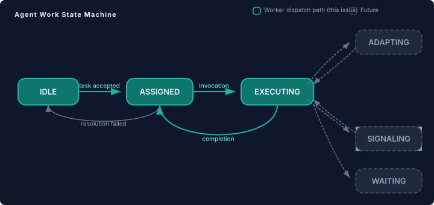
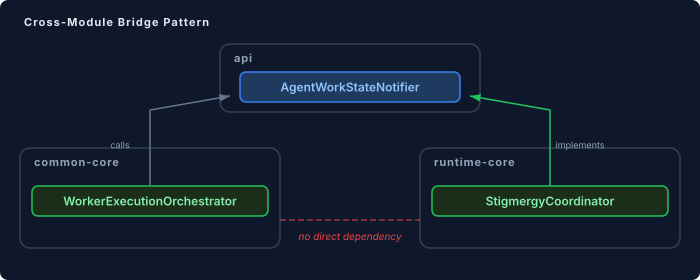

# Giving Each Agent a Heartbeat

Continued from [The Single Source of Truth Problem in Multi-Agent Authority](2026-11-02-mdp02-topology-aware-engine.md).

The engine knows whether an agent exists. Three states — JOINING, ACTIVE, DEPARTED — cover the membership lifecycle. But "active" is a big word. An active agent might be waiting for a task assignment, executing a worker function, blocked on a dependency, or mid-adaptation after receiving contradictory evidence. The platform can't distinguish any of these. From the engine's perspective, an active agent is a boolean: present or not.

This matters more than it sounds. Consider a dashboard monitoring a multi-agent case. Twelve agents are ACTIVE. Are they working? Idle? Stuck? The dashboard can't say. Consider a topology coordinator deciding whether to provision a thirteenth agent — it needs to know whether the existing agents are saturated or sitting idle. Consider a degradation policy that should shed load from overworked agents — it can't identify which agents are overworked because "working" isn't a state the engine tracks.

The membership lifecycle tells you *who's at the table*. The work lifecycle tells you *what they're doing*.

## Six states, not three

`AgentWorkState` extends the per-agent model with what an agent is actually doing at any given moment:

```java
public enum AgentWorkState {
  IDLE,
  ASSIGNED,
  EXECUTING,
  ADAPTING,
  SIGNALING,
  WAITING
}
```

The first three carry the worker dispatch path — the engine fires IDLE → ASSIGNED when a task is accepted, ASSIGNED → EXECUTING when the worker function begins, and EXECUTING → IDLE when it completes or fails. These transitions happen mechanically in the execution orchestrator, not as advisory events that a listener might miss. The state machine is enforced: an agent in IDLE can't jump to EXECUTING without passing through ASSIGNED. Invalid transitions throw.



The last three — ADAPTING, SIGNALING, WAITING — exist in the enum and validate in the state machine, but nothing fires them yet. They're the vocabulary for mid-execution states that future work will need: an agent pausing to adapt its approach after new evidence, depositing a stigmergic signal mid-execution, or blocked on a dependency from another agent. Defining them now means the state machine won't need breaking changes when those features land.

## The listener contract

Work state transitions need consumers. A dashboard needs to update. A metrics exporter needs to count. An agency bridge needs to adjust prompts when an agent starts executing versus sitting idle.

`AgentWorkLifecycleListener` follows the same pattern as `SwarmCoordinationListener` — default no-op methods, multi-instance via CDI `Instance`, consumers override only what they care about:

```java
public interface AgentWorkLifecycleListener {
  default void onWorkStateChanged(UUID caseId, String agentId,
      AgentWorkState from, AgentWorkState to) {}
  default void onTaskAssigned(UUID caseId, String agentId,
      String taskId, Map<String, Object> context) {}
  default void onRoleAdopted(UUID caseId, String agentId,
      String groupId, String role) {}
  default void onRoleReleased(UUID caseId, String agentId,
      String groupId, String role) {}
  // ...
}
```

`onWorkStateChanged` fires on every transition — the raw state machine signal. `onTaskAssigned` is richer: it fires alongside the IDLE → ASSIGNED transition but carries the task identifier and context map, giving the listener enough information to correlate the agent's work with the broader case. A metrics listener counts state changes. An agency bridge gets both the transition and the task identity. They coexist without interference.

The role lifecycle methods — `onRoleAdopted` and `onRoleReleased` — are surface only in this iteration. No code fires them yet. They exist because the MOISE+ society model needs agents to adopt and release roles dynamically at runtime, and the SPI contract should be stable before the group management code that fires these events lands. Defining the surface now means agency and eidos can code against it without waiting for the orchestration layer.

## The module boundary problem

Here's where the design needed actual thought, not just pattern-following.

`WorkerExecutionOrchestrator` — the class that dispatches workers and needs to fire state transitions — lives in `common-core`. `StigmergyCoordinator` — the class that owns per-agent state and validates transitions — lives in `runtime-core`. Runtime-core depends on common-core. Common-core can't depend on runtime-core. Direct method calls across the boundary are impossible.



The fix is an api-level bridge: `AgentWorkStateNotifier`. Two methods — `transitionWorkState` and `taskAssigned`. The orchestrator calls the interface. StigmergyCoordinator implements it. CDI wires the right implementation at runtime; a no-op default keeps non-swarm deployments working.

This is the same pattern `WorkerStatusListener` uses — a thin api-level interface that lets common-core communicate upward to runtime-core without knowing what's on the other end. The interface has two methods, not six, because the orchestrator only drives the dispatch-path transitions. Role lifecycle events and the future mid-execution states will be fired by different components — the group manager, the signal deposit path, the dependency tracker — each calling the appropriate listener method directly on StigmergyCoordinator.

## The try-finally contract

One detail that's easy to get wrong: what happens when worker execution fails after the ASSIGNED transition but before completion? The agent gets stuck in ASSIGNED or EXECUTING forever. No timeout resets it. No watchdog clears it. The state just lies.

The fix is structural, not defensive. The execution path wraps the worker invocation section in a try-finally — the finally block transitions the agent back to IDLE regardless of how the execution exits. Success, failure, exception — the agent always returns to IDLE. The state machine validates ASSIGNED → IDLE (for resolution failures before execution starts) and EXECUTING → IDLE (for normal completion or mid-execution failures). Both paths are legitimate and tested.

This is a pattern worth internalising for any state machine that's driven by fallible code: if a state represents "I'm doing something," the transition out of that state must be in a finally block. Relying on the happy path to clean up state is relying on the path that, by definition, won't always run.

## Why per-agent state matters for multi-agent platforms

Most multi-agent frameworks treat agents as interchangeable message endpoints. The framework knows the agent exists, routes messages to it, and watches for a response. What the agent is doing between receiving a message and producing a response is a black box. This works fine for simple request-response patterns — you send a prompt, you get a completion.

It stops working when agents are autonomous. An agent in a swarm can be mid-execution on one task when a topology change rebalances work. An agent can be waiting on a dependency from a peer that's itself adapting to new evidence. An agent can be signaling to the swarm while simultaneously executing — depositing a stigmergic trail marker as a side-effect of its primary work. Without per-agent work state, the platform has no basis for intelligent scheduling, graceful degradation, or workload-aware provisioning.

The six states aren't arbitrary. They map to the actual things an agent does in a cooperative multi-agent system: idle (available for work), assigned (task accepted but not yet running), executing (doing the work), adapting (revising approach based on new information), signaling (communicating with peers via stigmergy), and waiting (blocked on a dependency). Any platform that takes agent autonomy seriously will need this vocabulary — or something isomorphic to it.

The vocabulary is the easy part. The enforcement — invalid transitions throw, state resets on departure, try-finally on the execution path — is what makes it real.
