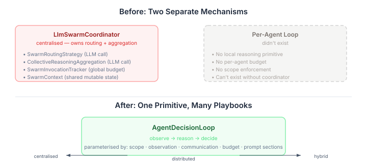
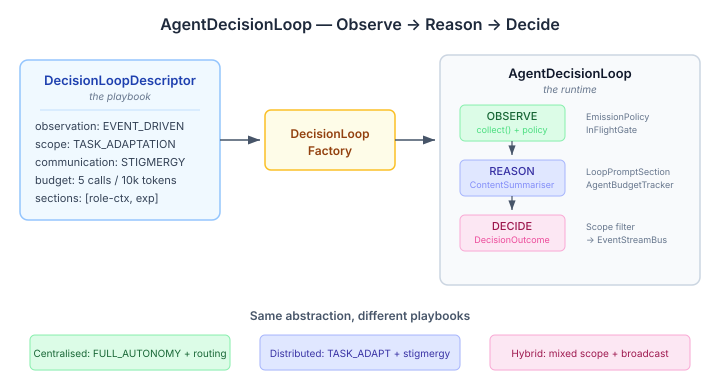

# The Playbook That Replaces the Coordinator

Continued from [Giving Each Agent a Heartbeat](2026-11-02-mdp03-per-agent-heartbeat.md).

The `LlmSwarmCoordinator` was the first thing we built that could make a multi-agent system behave intelligently. It observes the swarm — roles, teams, progress, convergence — then invokes an LLM to decide what to do: which agents to route, how to synthesise their outputs, when to provision more members. It works. And it's the wrong abstraction.

The coordinator assumes centralised control. One object holds the swarm context, owns the budget, assembles the prompt, calls the LLM, and interprets the result. The entire reasoning cycle — observe, reason, act — is embedded in a single class designed for a single topology. When we started building distributed coordination, the question wasn't how to extend the coordinator. It was how to extract the reasoning cycle from it.

## The insight: it's the same loop everywhere

A centralised coordinator observes global swarm state, reasons about routing, and produces team assignments. A local agent in a distributed topology observes its neighbourhood via stigmergy, reasons about its next action, and deposits a signal. These sound different. Structurally, they're identical: observe some environment, invoke an LLM to reason about what was observed, produce a decision.

The differences aren't in the cycle — they're in the parameters. What you observe (global state vs. local signals). What scope of decisions you're allowed to make (full autonomy vs. stimulus-driven). How you communicate results (broadcast vs. stigmergy). How much LLM budget you have. Which prompt sections frame the reasoning.



Once I saw it this way, the design fell out naturally. The coordinator and the per-agent loop aren't different things. They're the same thing with different configuration.

## Playbooks, not builders

The natural next question: if the loop is parameterised, what does the configuration look like?

My first instinct was a builder — `AgentDecisionLoop.Builder`, set some fields, call `.build()`. We already have `SwarmCoordinatorBuilder` doing exactly this for the existing coordinator. But builders encode configuration as code. You can't inspect a running loop's configuration without reading the source that built it. You can't declare a loop in YAML. You can't compare two loops' configurations or serialise one for debugging.

A decision loop is a recipe — observation strategy, scope, communication mode, budget, prompt sections. It's data. So it should be a data type.

```java
public record DecisionLoopDescriptor(
    String name,
    ObservationStrategy observationStrategy,
    DecisionScope scope,
    CommunicationMode communicationMode,
    AgentBudgetPolicy budgetPolicy,
    List<String> promptSectionNames
) { }
```

The descriptor is the playbook. The runtime — `AgentDecisionLoop` — executes it. A factory assembles the runtime from a descriptor by resolving prompt section names from a registry, constructing the right emission policy, and wiring the budget tracker. The descriptor is the thing you configure; the runtime is the thing that runs.

This split matters for a practical reason: YAML parity. The engine already has a principle that YAML and Java are peer representations of the same configuration. When we get to `.loop.yaml` files, the descriptor is the type the YAML deserialises into. If we'd used a builder with lambda fields, that path would be blocked.

## Composing what already exists

The decision loop doesn't invent a new execution model. It composes existing primitives from the summarisation pipeline.



The **observe** phase is a `SummarisationRunner` — the same tick-driven pipeline that already handles event accumulation and emission policies across the platform. For event-driven observation, the emission policy fires on every event. For tick-driven, it fires on a time window. For demand-driven, nothing fires until an explicit `flush()`.

The **reason** phase is a `ContentSummariser` — the existing async LLM invocation interface. The factory wraps it with two decorators: a `SectionAwareContentSummariser` that prepends prompt section contributions, and a budget-aware gate that calls `tryAcquire()` before each invocation. An `InFlightGate` prevents concurrent LLM calls.

The **decide** phase is the output: a `DecisionOutcome`. This is the piece that didn't exist before.

## Bridging two action models

The existing codebase had two ways for LLM reasoning to affect the world. `RoutingDecision` and `AggregationResult` are return values — the coordinator calls the LLM and gets back a structured answer. `EnvironmentWriter` is write-back — a local agent stores observations, deposits signals, and writes context entries as side effects.

These are fundamentally different execution models. Return values flow through the caller's control. Write-backs happen as side effects during processing. The decision loop needed to handle both, because the same loop primitive should work whether the topology is centralised (return-value routing) or distributed (write-back stigmergy).

```java
public sealed interface DecisionOutcome {
    record WriteBack(List<Observation> observations,
                     List<SignalDeposit> signals,
                     List<ContextWrite> contextWrites) implements DecisionOutcome {}
    record Route(RoutingDecision decision) implements DecisionOutcome {}
    record Aggregate(AggregationResult result) implements DecisionOutcome {}
    record Composite(List<DecisionOutcome> outcomes) implements DecisionOutcome {}
    record ScopeGated(DecisionType attempted,
                      DecisionOutcome rejected) implements DecisionOutcome {}
}
```

The loop produces `DecisionOutcome`. It doesn't execute it. The topology layer — the thing that knows whether this is a centralised coordinator or a distributed agent — decides how to apply the outcome. Centralised topologies pattern-match on `Route` and `Aggregate`. Distributed topologies pattern-match on `WriteBack` and call `EnvironmentWriter`. The loop doesn't care.

`ScopeGated` captures what the LLM tried but the scope filter rejected. A `STIMULUS_DRIVEN` agent that attempts a `PROVISIONING` action gets a logged rejection, not a silent drop. The topology layer sees what was attempted, not just what was permitted — useful for observability and for tuning scope constraints.

## Why this matters outside the engine

Multi-agent coordination frameworks tend to hardcode the coordination pattern into the architecture. You build a centralised coordinator, and then every agent has to route through it. You build peer-to-peer messaging, and then there's no way to have a coordinator. The topology is baked into the infrastructure.

The playbook model makes the topology a configuration choice. A `DecisionLoopDescriptor` with `FULL_AUTONOMY` scope and prompt sections for routing is a centralised coordinator. The same type with `TASK_ADAPTATION` scope and stigmergy communication is a local agent in a distributed topology. The same type with mixed scope and broadcast is a hybrid coordinator. Three topologies, one primitive, different YAML files.

This isn't theoretical. The next step — `CoordinationTopology` SPI — is primarily a factory for descriptors and an executor for outcomes. The topology doesn't implement coordination logic. It configures loops and applies their decisions. The intelligence stays in the loop; the coordination pattern stays in the playbook.
