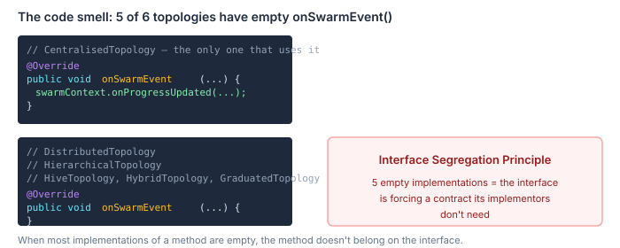
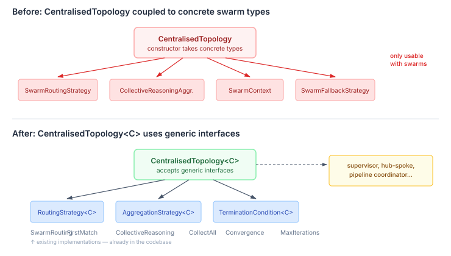

# The Interfaces Were Already There

We built the autonomy budget system across three batches — core types, telemetry, then integration across six topology implementations. All tests passing, code landed on main. Then I ran a full code review across the entire surface. The review caught real bugs (the summariser wasn't emitting telemetry events — the enterprise feedback loop had no data source). But the more interesting finding was architectural, not functional.

The review asked: "is everything generic that can be, so we can easily support other topologies?" The budget package passed cleanly — nothing in it references any specific topology type. Then I looked at `CentralisedTopology` itself, and the code was telling a story I'd missed during implementation.

## Five empty methods



`CoordinationTopology` is the SPI that all topology implementations conform to. It has three methods: `configure()`, `onSwarmEvent()`, and `onFeedback()`. Five of the six topologies we built — Distributed, Hierarchical, Hive, Hybrid, Graduated — implement `onSwarmEvent()` as an empty method. Only `CentralisedTopology` does anything with swarm events.

Five empty implementations of the same method is a textbook Interface Segregation Principle violation. The interface is forcing a swarm-specific contract on implementations that aren't swarms. A future `MeshTopology` or `PipelineTopology` would inherit the same pointless obligation.

This was already tracked as agency#386. But the budget review surfaced something worse.

## The constructor that lied about its abstraction level

`CentralisedTopology` is supposed to be a reusable pattern — one coordinator directing workers through three decision loops (team formation, collective reasoning, provisioning). That pattern isn't swarm-specific. A supervisor topology, a hub-and-spoke topology, a pipeline coordinator — they all fit the same 3-loop shape with different strategy implementations.

But the constructor tells a different story:

```java
public CentralisedTopology(
    SwarmContext swarmContext,
    SwarmRoutingStrategy routingStrategy,
    CollectiveReasoningAggregation aggregation,
    TerminationCondition<SwarmContext> terminationCondition,
    SwarmFallbackStrategy fallbackStrategy,
    // ...
```

Every parameter except `promptSectionNames` is a concrete swarm type. To use the centralised coordination pattern for a non-swarm topology, you'd have to provide swarm components you don't need.

Here's what makes this frustrating: the generic interfaces already exist. Agency has `RoutingStrategy<T>` with five implementations — `FirstMatchRouting`, `RoundRobinRouting`, `SelectAllRouting`, `SequentialRouting`, and the swarm-specific `SwarmRoutingStrategy`. It has `AggregationStrategy<T>` with five implementations — `CollectAll`, `MajorityVote`, `PassThrough`, `AuctionAggregation`, and `CollectiveReasoningAggregation`. `TerminationCondition<T>` is already generic.



The infrastructure for a generic `CentralisedTopology<C>` was sitting there the whole time. We just didn't use it.

## Why this happens

Implementation pressure. When you're building a swarm coordinator bottom-up, you reach for the concrete types because they're what you're testing against. `SwarmRoutingStrategy` has the LLM integration, the pre-filter, the experience replay — of course you pass it directly. The generic `RoutingStrategy<T>` interface feels like an unnecessary indirection when you have exactly one implementation.

The problem surfaces when you build the second topology. And the third. And the fourth. By topology six, the pattern is clear: the 3-loop structure is the value, the concrete swarm components are just one parameterisation of it. But by then, the constructor signature is load-bearing — tests depend on it, the builder constructs it, and the coupling feels like a fact rather than a choice.

The code review caught this because it asked the right question at the right time: not "does this work?" but "can someone else use this?" The functional review found bugs. The genericity review found a design constraint masquerading as an implementation detail.

## The fix

Parameterise `CentralisedTopology` on the context type:

```java
public class CentralisedTopology<C> implements CoordinationTopology {
    private final C coordinationContext;
    private final RoutingStrategy<C> routingStrategy;
    private final AggregationStrategy<C> aggregation;
    private final TerminationCondition<C> terminationCondition;
    // ...
```

`SwarmCoordinatorBuilder.buildTopology()` creates a `CentralisedTopology<SwarmContext>`. A future supervisor builder creates a `CentralisedTopology<SupervisorContext>`. The 3-loop pattern is reusable. `SwarmFallbackStrategy` dissolves — fallback is already handled inside `SwarmRoutingStrategy.heuristicFallback()`. It was a routing concern sitting at the wrong level.

This is filed as agency#401, depending on #386 to resolve the `onSwarmEvent` interface coupling. The budget system, the topology implementations, the decision loop — all topology-generic. `CentralisedTopology`'s constructor is the last piece of swarm coupling in the topology layer.

The interfaces were already there. We just needed the right question to see them.
