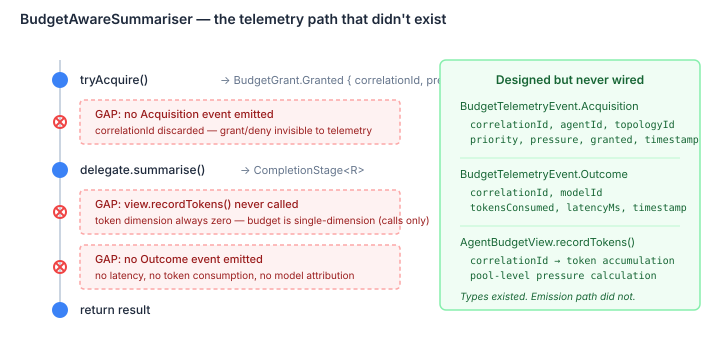

# The Budget That Couldn't Count

The autonomy budget system was designed with two dimensions: calls and tokens. Each agent gets a view into a shared pool, the view enforces per-agent limits, and the pool enforces topology-wide limits with a reserve partition for coordinators. The architecture is clean — dual-dimension governance with priority-based partitioning, pressure signals that flow back to the decision loop, and a sealed telemetry event model with paired Acquisition and Outcome records for the enterprise feedback path.

One problem. The token dimension was dead. Every agent's token pressure was zero, always, regardless of how many tokens the underlying LLM consumed. The budget was single-dimension — calls only — and nobody noticed because calls were the binding constraint in every test.

## Three gaps, one wrapper

`BudgetAwareSummariser` is a decorator around `ContentSummariser` — the generic interface that wraps LLM calls in the decision loop. It sits at the exact point where budget governance meets model invocation. Its job: acquire budget before delegating, record consumption after, emit telemetry throughout.

Here's what it actually did:

```java
public CompletionStage<R> summarise(List<T> items, @Nullable R previous) {
    BudgetGrant grant = view.tryAcquire();
    if (grant instanceof BudgetGrant.Denied) {
        return CompletableFuture.completedFuture(previous);
    }
    return delegate.summarise(items, previous);
}
```

Six lines. Acquire or deny. Delegate or return previous. No token recording. No telemetry events. The `correlationId` on the grant — the key that ties an acquisition to its outcome — was acquired and immediately discarded.



The telemetry types were fully specified. `BudgetTelemetryEvent.Acquisition` carries the correlationId, agent identity, topology identity, priority, pressure, and whether the grant succeeded. `BudgetTelemetryEvent.Outcome` carries the correlationId back, along with model ID, tokens consumed, and latency. Paired events, correlated by ID, designed for an enterprise feedback loop.

The types existed. The emission path did not.

## Why this matters beyond testing

In a single-agent system, you can eyeball token consumption from your provider's dashboard. In a multi-agent system with topology-aware budget partitioning, you can't. Each agent draws from a shared pool, coordinators have reserved capacity, and pressure signals affect future acquisition decisions. If the token dimension is dead, every agent looks equally cheap regardless of whether it consumes 500 tokens or 50,000. The budget system degrades to a rate limiter — useful, but not what it was designed to be.

The practical consequence: an agent running a summarisation sweep over a large context window would exhaust the token budget of a shared pool while the call-based budget showed plenty of headroom. No pressure signal, no degradation, no rebalancing. The coordinator, running at RESERVED priority, would see no reason to intervene. The cost overrun would only surface in the invoice.

This is the gap between "the tests pass" and "the system works." Call-based budgets are a coarse proxy. Token-based budgets are the actual cost model. Without token recording, the budget system was governing a fiction.

## The fix

The decorator needed three additions: emit Acquisition on every `tryAcquire()` (both granted and denied), record tokens after delegation via `view.recordTokens()`, and emit Outcome with latency and consumption. The correlationId flows through the entire path — from pool grant to acquisition event to outcome event — so any downstream consumer can reconstruct the full lifecycle of a single budget acquisition.

```java
return delegate.summarise(items, previous)
    .whenComplete((result, error) -> {
        long latencyMs = (System.nanoTime() - startNanos) / 1_000_000;
        long tokens = (error == null && result != null)
                      ? tokenEstimator.applyAsLong(result) : 0L;
        view.recordTokens(granted.correlationId(), tokens);
        eventSink.accept(new BudgetTelemetryEvent.Outcome(
                granted.correlationId(), modelId, tokens,
                latencyMs, Instant.now()));
    });
```

Token extraction is pluggable — a `ToLongFunction<R>` injected at construction. The decorator doesn't know or care what R is. For decision loops where the result carries token metadata, the estimator extracts it. For opaque wrappers, it can estimate or report zero. The mechanism is in place; wiring the actual token source is a function of the LLM client integration, not the budget layer.

The `whenComplete` callback fires on both success and failure. On delegate failure, tokens are recorded as zero but the Outcome event still emits — the budget acquired a grant, spent wall-clock time, and produced nothing. That's exactly the kind of signal a cost governance system needs to capture.

## The second code path

`SwarmCoordinatorBuilder` has two construction methods: `build()` creates an `LlmSwarmCoordinator` directly. `buildTopology()` creates the same routing and aggregation components but wraps them in a `CentralisedTopology`. Both methods construct a `SwarmRoutingStrategy` and `CollectiveReasoningAggregation`. Only `build()` called `setBudgetPool()` on them.

This is copy-paste divergence. The second code path was added for the topology layer, constructed the same components, but missed the budget wiring because it wasn't in the template the developer was working from. The routing strategy's budget check — `if (budgetPool != null)` — silently treated a missing pool as "budget governance not configured" rather than "budget governance accidentally omitted." Fail-open by design, which is the right default for optional features and exactly the wrong default for cost controls.

## Defensive contracts

The review also found that `BudgetGrant` records accepted null fields without complaint. A `Granted` with a null `correlationId` would produce a telemetry event with a null correlation key — a silent data quality failure in any downstream consumer. `AutonomyBudgetPool.createView()` silently replaced an existing view on duplicate agent ID, orphaning the old view's local counters while the pool-level counters still reflected its acquisitions.

These are the kind of bugs that don't show up in functional tests because the happy path never hits them. They surface under lifecycle violations — an agent that registers twice because a retry path didn't check, a race between registration and the first acquisition. Compact record constructors with `Objects.requireNonNull` and `putIfAbsent` with an `IllegalStateException` on collision. Small changes, but they convert silent corruption into immediate failures.

The budget system had all the right types. It just needed the wiring.
