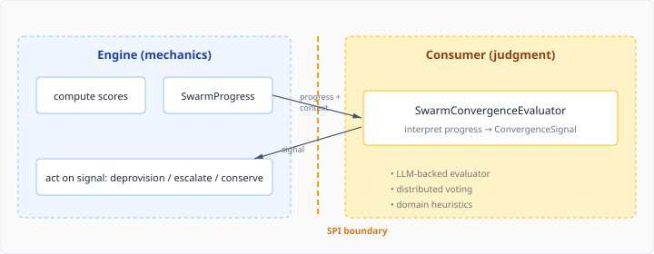
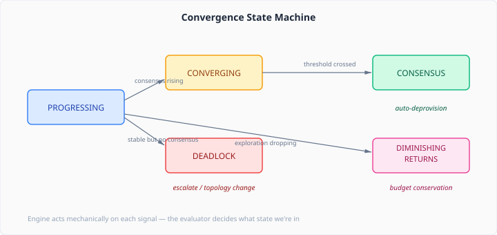

# When Should the Swarm Stop?

A multi-agent swarm that does not know when to stop is a swarm that burns budget until someone pulls the plug. The hard part is not detecting that agents are still running — it is deciding whether their continued work is productive.

The CaseHub engine already computed three convergence scores on every tick: how fast agents are exploring new ground (exploration pace), how much they agree (consensus), and how stable their role assignments are (stability). These three numbers told the engine what was happening. What they did not tell it was what to *do* about it.

The evaluation logic was hardcoded inside `SwarmProgressTracker`. High consensus with stable roles? Good, probably done. Low exploration? Maybe diminishing returns. The thresholds were baked in. This works for exactly one domain — whichever domain the hardcoded values happen to fit.

## The problem with one-size-fits-all convergence

Consider two swarms running on the same engine. A legal document review swarm reaches consensus when three agents independently flag the same clause as problematic — high agreement on a narrow surface. A market analysis swarm reaches consensus when agents stop discovering new signals — low exploration pace over a sustained window. Same word, completely different mechanics.

Hardcoded thresholds cannot distinguish these cases. Worse, the engine was making mechanical decisions — deprovisioning idle agents, escalating stuck ones — based on convergence judgments it had no business making. The engine knows *how* to deprovision. It should not know *when*.

## Separating mechanics from judgment

The fix is an SPI that draws the line between what the engine computes and what the consumer interprets.



The engine computes `SwarmProgress` — three scores, timestamped, objective. The consumer implements `SwarmConvergenceEvaluator` and returns a `ConvergenceSignal`: a state, a confidence, and a reason.

```java
@FunctionalInterface
public interface SwarmConvergenceEvaluator {
  ConvergenceSignal evaluate(UUID caseId, SwarmProgress progress, ConvergenceContext context);
}
```

Five states, each with a clear mechanical response:



The engine does not care *how* the evaluator reaches its conclusion. A threshold check, an LLM call, a distributed vote across agents — the mechanics are identical. The engine receives CONSENSUS, deprovisions idle agents, and moves on.

## Why this matters beyond CaseHub

Any multi-agent framework faces this problem. The typical solution is to hardcode a timeout, a max-iteration count, or a simple "everyone agreed" check. These work for demos. They break in production, where:

- Different domains have different convergence semantics
- The cost of stopping too early (missed signals) differs from stopping too late (wasted compute)
- Convergence detection itself may need to be learned, not coded

Making convergence evaluation pluggable means the framework does not need to anticipate every domain. A legal-tech consumer writes an evaluator that understands what agreement means for document review. A financial consumer writes one that understands what stability means for portfolio analysis. The engine runs identically in both cases.

The default `ThresholdConvergenceEvaluator` ships with the engine — basic threshold checks that match the previously hardcoded behaviour. It is annotated `@DefaultBean`, so any consumer-provided implementation replaces it automatically. No configuration, no feature flags. Just implement the interface.

## The pattern

This is not a new idea. It is the same separation that rule engines apply between the match algorithm (engine) and the conflict resolution strategy (consumer). The engine provides the pattern-matching mechanics. The strategy decides which matched rule fires. Neither knows the other's business.

Convergence evaluation follows the same split. The engine provides the signal computation mechanics. The evaluator decides what those signals mean. The engine acts on the evaluator's judgment without understanding it.

The interface is `@FunctionalInterface` for a reason — a lambda that returns CONSENSUS is a valid evaluator. Start simple, replace when the domain demands it.
