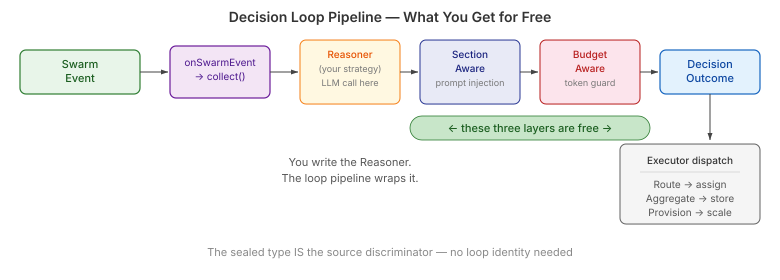
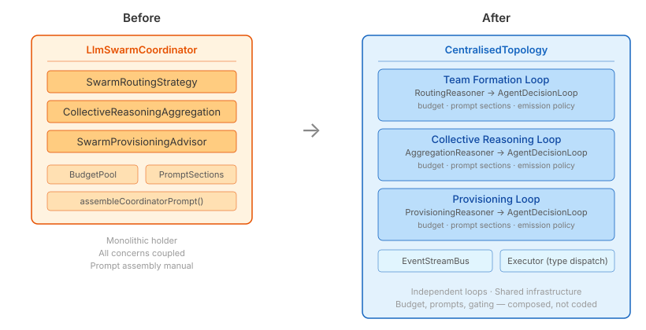
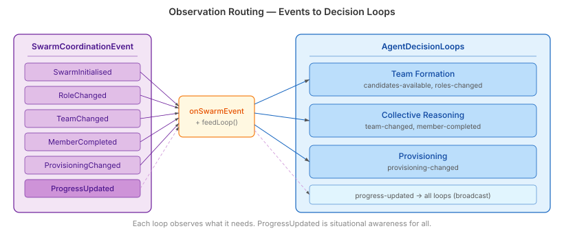

# The Coordinator That Dissolved

Every multi-agent system grows a coordinator. A class that holds routing, aggregation, provisioning, budgets, prompt sections, termination — a gravitational well for every concern that touches coordination. Ours was called `LlmSwarmCoordinator`. Nine fields, one prompt-assembly method, accessor methods for the rest.

The builder had two paths: `build()` returned the coordinator, `buildTopology()` returned a `CentralisedTopology` behind the `CoordinationTopology` interface. Two ways to build the same thing. A clear sign that one of them should not exist.

## The Infrastructure It Was Reimplementing

`CentralisedTopology` already declared three `DecisionLoopDescriptor`s — team formation, collective reasoning, provisioning — each with an observation strategy, a decision scope, and a budget priority. The descriptors specified *what coordination should happen*. The coordinator just held *the things that do coordination*.

Meanwhile, the `AgentDecisionLoop` pipeline — built in the previous iteration — composes a `ContentSummariser` (the reasoner) with prompt section injection, budget checking, and concurrency gating. You write the reasoner. The factory wraps it.



The coordinator was reimplementing all of this by hand. It called `pool.tryAcquire()` in each strategy. It assembled prompts by iterating sections into a StringBuilder. It checked budgets before every LLM call. The decision loop pipeline does all of that through composition — `SectionAwareContentSummariser` for prompts, `BudgetAwareSummariser` for tokens, `InFlightGate` for deduplication. The coordinator was sixty lines of plumbing that already existed.

## Bridging the Type Gap

The gap was a type mismatch. `SwarmRoutingStrategy` operates on `RoutingContext<SwarmContext>` and returns a `RoutingDecision`. The loop wants `ContentSummariser<ObservationEvent, DecisionOutcome>`. Different type worlds.

Three adapter classes bridge them. `RoutingReasoner` implements `ContentSummariser`, translates observation events into a routing context, calls the strategy, wraps the result as `DecisionOutcome.Route`. Same pattern for `AggregationReasoner` and `ProvisioningReasoner`. Each is under 40 lines. The existing strategies — with their fallback logic, experience replay, prompt customisation — remain untouched.



This is the key point: the adapters don't replace the LLM strategies. They plug them into infrastructure that handles everything around the LLM call — the concern the coordinator was hand-coding.

## The Type That Prevented a Hack

Provisioning needed a home in the `DecisionOutcome` sealed hierarchy. The quick option was `WriteBack` — deposit a signal, write a context key, done. No new types.

The design review caught the flaw. `DecisionOutcomeExecutor` dispatches on outcome type. The `EventStreamBus` carries no source metadata — no loop name, no producer tag. If provisioning used `WriteBack`, the executor could not distinguish a provisioning write-back from a generic one. Loop-identity dispatching was architecturally impossible.

```java
record Provision(ProvisioningAdvice advice) implements DecisionOutcome {
    public Provision {
        Objects.requireNonNull(advice, "advice must not be null");
    }
}
```

One record in the sealed hierarchy. The compiler enforces exhaustive handling in every executor — every topology that pattern-matches on outcomes either has a `case Provision` arm or it does not compile. The convenient hack would have shipped silently. The type system catches it at compile time.

## Where Events Meet Loops

The topology's `onSwarmEvent` bridges the domain event model to the observation pipeline. Each event type routes to the loop that cares about it. Team formation gets candidate and role events. Collective reasoning gets team changes and member completions. Provisioning gets scaling signals. Progress updates broadcast to all three — every loop needs situational awareness.



Before `configure()` is called, the loops list is empty and events update only the `SwarmContext`. After `configure()`, they flow into independent pipelines, each with its own budget, emission policy, and prompt sections. The routing is name-based — `feedLoop` finds the loop by descriptor name and calls `collect()`. No event bus registration, no listener interfaces, no wiring XML. A stream filter and an `ifPresent`.

## What This Actually Gives You

Three things a monolithic coordinator cannot provide.

**Independent observation cadences.** Team formation is event-driven — it fires when candidates appear. Provisioning is tick-driven — it polls on a five-second window. A monolithic coordinator either processes everything on every event (wasteful) or processes everything on a timer (laggy). Separate loops let each concern observe on its own schedule.

**Per-concern budget isolation.** Each loop gets its own `AgentBudgetView` from the shared pool. Routing burning through tokens does not starve provisioning. The budget priority system means reserved loops survive even when the pool is under pressure. A coordinator that calls `pool.tryAcquire()` in each strategy gives you budget checking. Separate loops give you budget *isolation*.

**Pluggable reasoners without infrastructure changes.** Swap `SwarmRoutingStrategy` for a capability-based heuristic — the loop still handles prompt injection, budget gating, and concurrency control. The adapter boundary is a 40-line class. Everything behind it is yours; everything in front of it is free.

The coordinator did not fail. It dissolved — its responsibilities moved into infrastructure that was already there, waiting for the adapters to connect them.
