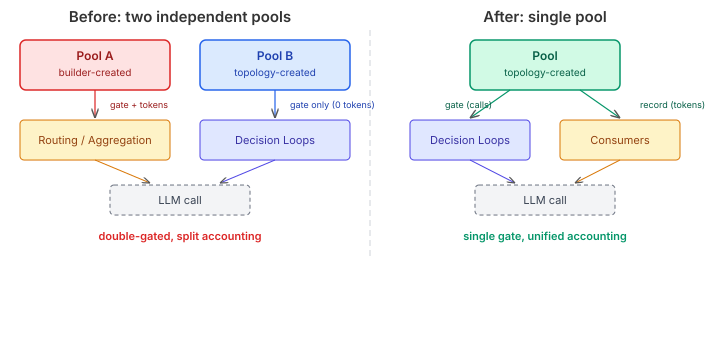

# The Pool That Was Two Pools

A previous session fixed the token-recording gap in `BudgetAwareSummariser` — the decorator that was acquiring budget grants but never recording what they cost. That fix wired telemetry events and token accounting into the right place. The budget system finally had both dimensions: calls and tokens.

Except it didn't. The tokens were being recorded on the wrong pool.

## Two layers, two pools

`SwarmCoordinatorBuilder` constructs the components that power a swarm — routing strategy, aggregation engine, provisioning advisor. As part of construction, it created an `AutonomyBudgetPool` and injected it into each component via `setBudgetPool()`. This pool tracked calls and tokens for direct LLM invocations inside those components.

Separately, `CentralisedTopology.configure()` creates its own `AutonomyBudgetPool` and passes it to the `DecisionLoopFactory`, which creates `AgentBudgetView` instances for each decision loop. The loops use `BudgetAwareSummariser` to gate calls through these views.

Two pools. Same type. Same policy. Different instances. Independent call counters. Independent token counters.



The routing strategy sits inside a decision loop. When the loop fires, `BudgetAwareSummariser` acquires a grant from Pool B (the topology's pool), then delegates to the routing reasoner, which delegates to `SwarmRoutingStrategy`, which acquires a second grant from Pool A (the builder's pool). One LLM call, two budget acquisitions, two pools that each think they're the authoritative cost ledger.

## Why two independent pools are worse than no pool

A single missing pool is an obvious gap — the null check fails open, no budget governance, you notice it in testing. Two pools that should be one is subtler.

The topology's pool never received token recordings. `BudgetAwareSummariser` was wired with a default token estimator of `r -> 0L` because the `DecisionOutcome` return type doesn't carry token metadata. So Pool B's `tokenCount` was permanently zero. Token-based enforcement through the decision loop path never triggered — the effective budget was call-only.

The builder's pool received token recordings from the direct consumers. But it was a separate instance from the pool that the decision loops gated against. Pressure signals from one pool didn't affect decisions gated by the other. An agent exhausting the token budget on Pool A had no effect on Pool B's willingness to grant new calls.

The budget system had governance, but it was governing two fictions independently.

## Where the fix lives

The question isn't "how do we merge two pools." Naively sharing a single pool causes double call-counting — `BudgetAwareSummariser` acquires once, then the consumer acquires again on the same pool. A budget of 50 calls becomes 25 actual LLM invocations. Worse, the consumer's second acquire can fail even though the summariser already committed the call, causing a heuristic fallback for a "counted" invocation.

The question is: which layer owns budget governance?

The answer: the decision loop. `BudgetAwareSummariser` is the call gate. It sits at the exact boundary between "should we invoke the model" and "invoke the model." The consumers — routing, aggregation, provisioning — are inside the loop. They don't need their own gate because they're already behind one.

Token recording is different. The consumer is where the LLM client returns token metadata. The decision loop can't extract it because `DecisionOutcome` doesn't carry it. So recording stays with the consumer, but pointing at the topology's pool instead of a builder-created one.

The mechanism is a `LongConsumer` callback — `setTokenRecorder()` — that the topology wires after creating its pool:

```java
routingStrategy.setTokenRecorder(t -> pool.recordTokens("routing", t));
aggregation.setTokenRecorder(t -> pool.recordTokens("aggregation", t));
```

The consumer checks `tokenRecorder` first, falls back to `budgetPool.recordTokens()` for the YAML path where consumers still operate outside decision loops. The builder no longer creates a pool at all.

## The construction-vs-composition pattern

This is a pattern worth naming. Two layers — construction and composition — each wiring the same cross-cutting concern independently. The builder constructs components and sets up budget gating. The topology later composes those components into a higher-level structure and sets up its own budget gating. Neither layer knows about the other's pool.

It happens whenever a builder and a lifecycle method both configure infrastructure. The fix is always the same: decide which layer owns the concern and strip it from the other. For budget governance, the composition layer (topology) owns it because that's where the execution model is defined. The construction layer (builder) just creates components — it doesn't know how they'll be composed.

The `setBudgetPool()` API remains on the consumers for paths where they run without a topology wrapper. But in the topology path, the builder doesn't touch budget at all. One pool, one gate, one set of counters. The budget can finally count.
