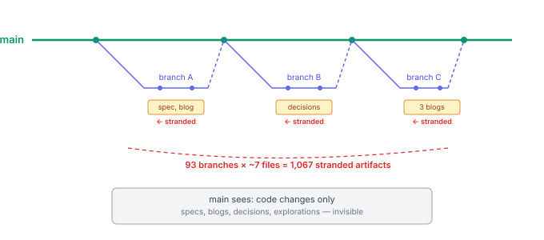

# The Artifacts Nobody Promoted

A hygiene scan at the end of a branch-close ceremony reported 1,157 open findings. Not bugs. Not test failures. Workspace artifacts — design specs, blog entries, decision records, exploration documents — sitting on closed branches that had never been promoted to main.

Ninety-three closed branches. An average of seven orphaned files each. Months of design thinking, invisible to anyone reading main.

## How artifacts drift

The development workflow splits into two repositories: the project repo (production code) and the workspace repo (design artifacts, plans, specs, blog entries). Code goes through the normal merge path — rebase onto main, squash, push. But workspace artifacts follow a different lifecycle. They're committed to the workspace branch during design and implementation. When the branch closes, the code gets merged. The workspace branch gets stamped with `chore: branch closed`. And the artifacts stay where they are.

The workspace branch stamp is a tombstone, not a merge. It marks the branch as complete, but it doesn't move the content. The spec that informed the implementation, the decisions that shaped the design, the blog entry that explains the reasoning — all of them live on a branch that nobody will ever check out again.

This is silent information loss. The code is on main. The reasoning behind it is on a dead branch. Six months from now, someone reading the code has no path from "what does this do" to "why was it built this way" without archaeology across dozens of closed branches.

## The shape of the problem

The 1,067 artifact findings broke down predictably. About a third were ephemeral scaffolding — `pipeline.state` files that track brainstorming progress, `.execute-progress` markers from plan execution. These are working files with no long-term value. They can be ignored.

The other two thirds were the real cost: design specs that document the reasoning behind architectural decisions. Decision records that capture what was considered and why one option was chosen over another. Blog entries that explain the practical implications of a change. Exploration documents from deep-analysis sessions where multiple approaches were evaluated.

All of them written. All of them committed. None of them reachable from main.

## Why this accumulates silently

Three factors compound to make this invisible:

The branch-close workflow focuses on code. The merge, squash, and push ceremony is built around getting production changes to main. Workspace artifacts aren't production code — they're not compiled, not tested, not deployed. They fall outside the merge's attention.

The workspace stamp is designed to be safe. It marks the branch as done without modifying main. This is correct for branches where the design work was invalidated or superseded. But it's applied uniformly — to branches where the artifacts are the permanent record alongside branches where they're scratch work.

Each branch only adds a few files. Seven files across one branch is unremarkable. Seven files across ninety-three branches is a thousand orphaned documents. The accumulation is linear and silent.

## The fix

Promotion is mechanical. For each closed workspace branch, diff its files against main. Skip ephemeral scaffolding (pipeline state, execution markers). For everything else — specs, blogs, decisions, explorations — cherry-pick to main if the content doesn't already exist there.

We promoted 196 artifacts from 59 closed branches across both workspace repos in one pass. A Python script iterated the branches, identified promotable files, and batch-committed them to main. The remaining 90 findings were branch-level warnings about the stamped branches themselves — the branches stay (cheap storage, audit trail), but their content is now reachable from main.

## The discipline gap

The real fix isn't the script. It's making artifact promotion part of the branch-close ceremony, not an afterthought. When `work-end` merges code to main, it should also promote workspace artifacts to workspace main. Same operation, same moment, same attention.

Design artifacts are not less important than code. They're the context that makes the code intelligible to the next person — or to you, six months from now. A codebase without its design history is a codebase where every question requires re-derivation from first principles. The artifacts exist specifically to prevent that. Leaving them on dead branches defeats the purpose of writing them.
