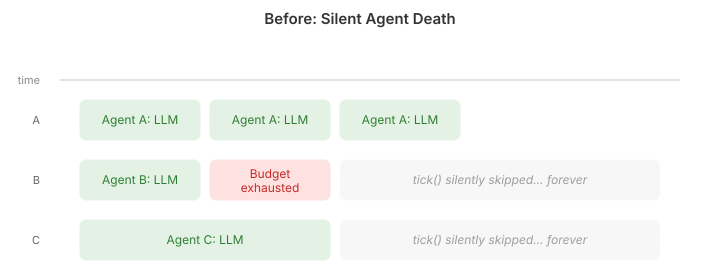
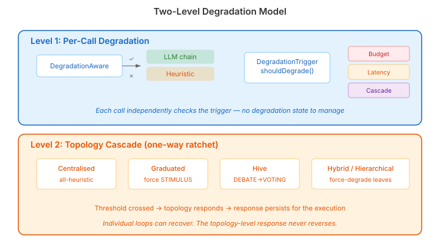

# When Agents Go Silent

Multi-agent systems have a failure mode that nobody talks about: agents that stop reasoning and nobody notices.

In a budget-constrained swarm — and every production swarm is budget-constrained — each agent has a finite number of LLM calls. When that budget runs out, what happens? In our system until this week, the answer was: the agent's `tick()` method silently returned. No error. No fallback. No signal to the topology. The agent just stopped participating, and the swarm continued as if nothing had changed.

This is worse than a crash. A crash is visible. Silent death is invisible. The topology keeps routing work to an agent that will never respond. The aggregator waits for results that will never arrive. The system degrades in ways that are impossible to diagnose from the outside.

The irony is that the heuristic fallback code already existed. `SwarmFallbackStrategy` had three methods — `fallbackRouting()`, `fallbackAggregation()`, `fallbackProvisioningAdvice()` — each encoding a simple heuristic: select all candidates, concatenate all outputs, grow if there's room. These are crude. They are also infinitely better than silence.

## Two levels

The fix has two layers, and they serve different purposes.

**Per-call degradation** operates at the summariser chain level. Before each LLM call, a `DegradationTrigger` answers one question: should this call be heuristic? The trigger is composable — budget exhaustion, latency breaches, and cascade signals are just implementations of a `boolean shouldDegrade()` interface, combined with OR semantics. If any trigger fires, the `DegradationAwareSummariser` delegates to a heuristic instead of the LLM chain.

The key design decision: degradation is stateless. There is no "degraded" flag to set and clear. The trigger is checked fresh on every call. Budget exhaustion is monotonic — once the budget is spent, it stays spent. Latency is transient — if the provider recovers, the next call goes through the LLM. Each call independently does the right thing, with no lifecycle management to get wrong.

**Topology cascade** operates at the structural level. When enough loops degrade (configurable threshold, fraction-based or priority-weighted), the topology responds with a one-way structural change. This is a ratchet — once it fires, it doesn't reverse, even if individual loops recover.

The cascade responses are topology-specific because different coordination structures have different failure semantics:

- **Centralised** forces all remaining loops to heuristic. If the routing loop can't reason, keeping the aggregation loop on LLM while it waits for routing results that will never arrive is pointless.
- **Graduated** forces all agents to `STIMULUS_DRIVEN` scope, concentrating decision authority. An agent that can only react to stimuli (rather than proactively reason) is still useful; an agent that silently drops decisions is not.
- **Hive** simplifies its orchestration pattern — DEBATE steps down to VOTING, VOTING to SUPERVISOR. Each step reduces the number of LLM calls needed to reach a coordination decision.
- **Distributed** does nothing. Independent agents degrade independently. No cascade makes sense when there is no coordination to protect.

## Why this matters

The real argument for graceful degradation is not about fault tolerance in the abstract. It is about the difference between a system that produces lower-quality output and a system that produces no output.

A swarm running on heuristics will route all candidates instead of selecting the best ones. It will concatenate all results instead of reasoning about them. It will provision new agents whenever there is room instead of considering whether they are needed. Every one of these decisions is worse than the LLM-backed version.

But every one of them is a decision. The swarm continues to function. Work gets routed. Results get aggregated. The topology knows which loops are degraded and has responded structurally. An operator monitoring `SwarmDegradedEvent` can see exactly which loops switched to heuristic, when, and whether cascade fired.

The alternative — the status quo until this week — was that the swarm silently became a collection of agents sending messages into a void.

Production multi-agent systems need the same operational discipline as any other distributed system. Circuit breakers, fallback paths, observable degradation, and structural responses to partial failure. The LLM is a remote service with a cost dimension that can be exhausted. Treating budget exhaustion as "the agent stops" is the multi-agent equivalent of letting a web server return nothing when the database is down. We would never accept that in a conventional system. We should not accept it in an agentic one.
