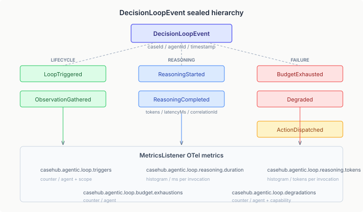
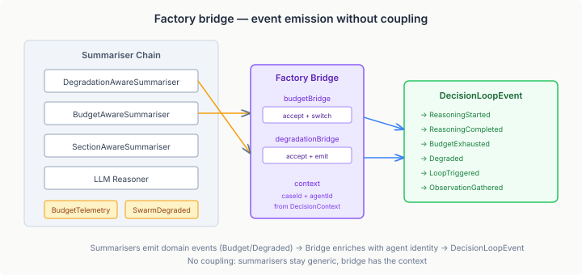

# The Feedback Loop That Was Missing

We shipped graceful degradation last week. Agents that exhaust their LLM budget now fall back to heuristics instead of going silent. The topology detects cascade failures and responds structurally. From the outside, the swarm keeps producing output. Problem solved.

Except we had no way to see any of it happening.

The degradation system fires `SwarmDegradedEvent` when a loop switches to heuristic. The budget system fires `BudgetTelemetryEvent` when a grant is acquired or denied. Both events exist. Both are consumed internally. Neither reaches the monitoring infrastructure. An operator watching Grafana would see the swarm's aggregate throughput drop and have no idea why — no per-agent latency, no token consumption, no degradation signals.

This is the gap between handling failure and understanding failure. You can build the world's most elegant fallback system, and it is operationally useless if nobody can see when it activates.

## Seven events, one sealed type

The fix is a sealed event hierarchy — `DecisionLoopEvent` — that captures every lifecycle point of a per-agent decision loop.



Seven variants, three categories:

**Lifecycle** events mark structural transitions. `LoopTriggered` fires when the factory creates a loop — it carries the agent's `DecisionScope` and `CommunicationMode`, which tells you what kind of reasoning this loop is configured for. `ObservationGathered` fires on each `collect()` call, recording what the loop is seeing.

**Reasoning** events bracket each LLM invocation. `ReasoningStarted` and `ReasoningCompleted` share a `correlationId` so you can pair them across async boundaries. `ReasoningCompleted` carries `tokensConsumed` and `latencyMs` — the two numbers that matter most for cost attribution and performance diagnosis.

**Failure** events signal degradation. `BudgetExhausted` fires when a budget grant is denied. `Degraded` fires when the degradation trigger activates, carrying the capability that degraded, the reason, and whether the fallback is active.

The common fields — `caseId`, `agentId`, `timestamp` — live on the sealed interface, not on each record. Every event carries agent identity, which is the whole point: you want per-agent metrics, not system-wide averages.

Why sealed? Because the `MetricsListener` uses an exhaustive switch. If we add an eighth event variant tomorrow, every consumer that pattern-matches on it gets a compile error. The type system enforces completeness — no silent gaps in observability.

## The bridge that connects them

The interesting design problem was not the event hierarchy. It was getting the events emitted without coupling the summariser chain to decision loop concerns.

The summariser chain is generic. `BudgetAwareSummariser<T, R>` wraps any `ContentSummariser` with budget gating. `DegradationAwareSummariser<T, R>` wraps any summariser with trigger-based fallback. Neither knows about `DecisionLoopEvent`, `caseId`, or `agentId`. They emit their own domain events — `BudgetTelemetryEvent` and `SwarmDegradedEvent` — through typed `Consumer<>` sinks.

The factory has the context. It creates the `DecisionContext` (which has `caseId` and `agentId`), and it creates the `Consumer<>` sinks that the summarisers will use. The bridge intercepts these sinks:



```java
Consumer<BudgetTelemetryEvent> budgetBridge = event -> {
    budgetEventSink.accept(event);      // original consumer still fires
    switch (event) {
        case Acquisition a when !a.granted() ->
            loopEventSink.accept(new BudgetExhausted(
                context.caseId(), context.agentId(), ...));
        case Acquisition a ->
            loopEventSink.accept(new ReasoningStarted(
                context.caseId(), context.agentId(), a.correlationId(), ...));
        case Outcome o ->
            loopEventSink.accept(new ReasoningCompleted(
                context.caseId(), context.agentId(), o.correlationId(),
                o.tokensConsumed(), o.latencyMs(), ...));
    }
};
```

The bridge is a decorator — the original consumer fires unchanged, and the `DecisionLoopEvent` is emitted alongside it. The summariser chain never sees the new event type. The factory holds the agent identity that enriches it.

This pattern matters beyond this specific use case. Any time you have a generic library emitting domain events and need to add cross-cutting concerns (identity, tracing, telemetry), the factory bridge is the right seam. The library stays generic, the bridge captures the context, and the output event carries everything a consumer needs.

## Five metrics, zero configuration

The `MetricsListener` already subscribes to `ExecutionEventListener` for OTel metrics on routing decisions, activation evaluations, and agent durations. Adding decision loop metrics was one method:

```java
@Override
public void onDecisionLoopEvent(DecisionLoopEvent event) {
    switch (event) {
        case LoopTriggered e ->
            loopTriggers.add(1, Attributes.of(AGENT, e.agentId(), SCOPE, e.scope().name()));
        case ReasoningCompleted e -> {
            reasoningDuration.record(e.latencyMs(), Attributes.of(AGENT, e.agentId()));
            reasoningTokens.record(e.tokensConsumed(), Attributes.of(AGENT, e.agentId()));
        }
        case BudgetExhausted e ->
            budgetExhaustions.add(1, Attributes.of(AGENT, e.agentId()));
        case Degraded e ->
            loopDegradations.add(1, Attributes.of(AGENT, e.agentId(), CAPABILITY, e.capability()));
        default -> {}
    }
}
```

Five new instruments — `loop.triggers`, `loop.reasoning.duration`, `loop.reasoning.tokens`, `loop.budget.exhaustions`, `loop.degradations` — all attributed per-agent. The `default` branch is deliberate: `ObservationGathered`, `ReasoningStarted`, and `ActionDispatched` are available for tracing but don't warrant counters in the default metrics path.

What an operator sees with these five metrics:

- **Which agents are still reasoning** — `loop.triggers` by agent, compared against `loop.degradations`
- **Where the budget is going** — `reasoning.tokens` by agent, shows token-hungry agents before they exhaust
- **Latency distribution** — `reasoning.duration` histogram by agent, catches the slow ones before they breach the degradation threshold
- **Degradation timeline** — `loop.degradations` counter, when combined with `budget.exhaustions`, shows whether degradation is budget-driven or latency-driven

None of this existed a week ago. Every multi-agent system I've seen in production has the same blind spot — aggregate metrics that tell you the system is slow, with no way to identify which agent, which loop, or which resource constraint is the cause.

## Why this matters

The observability gap in multi-agent systems is not a monitoring problem. It is a feedback loop problem. Without per-agent telemetry, you cannot answer the questions that improve the system: Are some agents consuming disproportionate budget? Is degradation firing because of budget or latency? Does the cascade threshold need tuning?

These are the same questions we ask about microservices, and they have the same answer: instrument the boundaries, attribute the metrics, and let operators reason about the data. The difference with multi-agent systems is that the "service" boundary is inside a single JVM — it is the decision loop, not the network call. Traditional APM does not see it. You have to build the instrumentation layer yourself.

The sealed event hierarchy gives you the type safety. The factory bridge gives you the wiring without coupling. OTel gives you the export path. The combination is a per-agent observability layer that runs alongside the coordination system, reports through existing infrastructure, and costs nothing when nobody is listening (OTel no-op meters are genuinely free).

We should have built this before the degradation system. You cannot tune what you cannot see, and you cannot diagnose what you cannot attribute. The feedback loop that was missing was not the one between agents — it was the one between the system and the people responsible for it.
