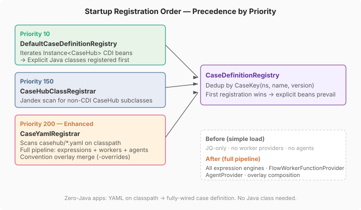

# The YAML That Didn't Need a Class

Every CaseHub definition in the engine requires a Java class — a one-line subclass of `YamlCaseHub` whose only job is to point at a YAML file:

```java
@ApplicationScoped
public class HelpDeskCaseHub extends YamlCaseHub {
    public HelpDeskCaseHub() { super("casehub/helpdesk-ticket.yaml"); }
}
```

That class exists so CDI can find the bean, inject its dependencies (expression engines, worker function providers, agent providers), and register the resulting `CaseDefinition`. Without it, the YAML sits on the classpath doing nothing.

For zero-Java applications — where the entire case definition lives in YAML and the app has no source code at all — this boilerplate class is the only thing between a pure-YAML project and a working case engine.

## What was already there

The engine already had a classpath scanner: `CaseYamlRegistrar`, a `ClasspathYamlRegistrar` SPI implementation that scans `casehub/` and `cases/` directories at startup. It was doing two thirds of the work — finding the YAML files and registering them. But it was calling `CaseDefinitionYamlMapper.load(InputStream)`, the simple overload that uses JQ-only expressions, no worker function providers, and no agent providers. Workers with `do:` blocks — the Serverless Workflow DSL that `FlowWorkerFunctionProvider` handles — were silently not wired.

The full pipeline has been available all along via a different `load()` overload that takes an `ObjectMapper`, `ExpressionEngineRegistry`, `WorkerFunctionProviderRegistry`, and `AgentProvider`. That's what `YamlCaseHub.getDefinition()` calls. The registrar just wasn't using it.

## The fix

We injected the full set of pipeline dependencies into `CaseYamlRegistrar`:

```java
@Inject ExpressionEngineRegistry expressionEngineRegistry;
@Inject @YamlMapper ObjectMapper objectMapper;
@Inject WorkerFunctionProviderRegistry workerFunctionProviderRegistry;
@Inject Instance<AgentProvider> agentProviderInstance;
```

The `register()` method now reads the YAML as a `JsonNode`, checks for a convention overlay (`-overrides` suffix — the same pattern `YamlCaseHub` uses), merges if found, and calls the full-pipeline `load()`. Expression engines, worker function providers, agent providers — all wired.

## Precedence handles itself

Precedence between explicit `CaseHub` beans and auto-discovered YAML handles itself through startup ordering.



`DefaultCaseDefinitionRegistry` registers CDI beans at priority 10. `CaseYamlRegistrar` runs at priority 200. The registry's dedup check means if a developer writes a `HelpDeskCaseHub` class AND has the YAML on the classpath, the explicit bean wins. No special precedence logic needed — the architecture already enforced it.

## Overlay composition

One decision worth calling out: we added overlay support to the registrar. `YamlCaseHub` has always supported a convention where `casehub/helpdesk-ticket-overrides.yaml` is deep-merged onto the base definition. We extended this to auto-discovered YAML. A zero-Java app can now customise a third-party case definition — override worker timeouts, add bindings, adjust milestones — by dropping an overrides file next to it. No code required.

The `deriveConventionPath()` method on `YamlCaseHub` was already a static utility doing the right thing. It just needed to be made `public` so the registrar could call it. Pure visibility change, one line.

## What this opens up

The immediate use case is the zero-Java helpdesk application. Drop YAML in `casehub/`, add the engine dependency, start the app. No Java class, no CDI wiring, no boilerplate.

The broader implication is that case definitions are now a pure data concern. A YAML file on the classpath is sufficient to run a fully-wired case — expression engines, `do:` block workers, agent providers, overlay composition, all of it. The Java class path remains available for anyone who needs programmatic augmentation via the `augment()` hook, but the default path is zero code.
