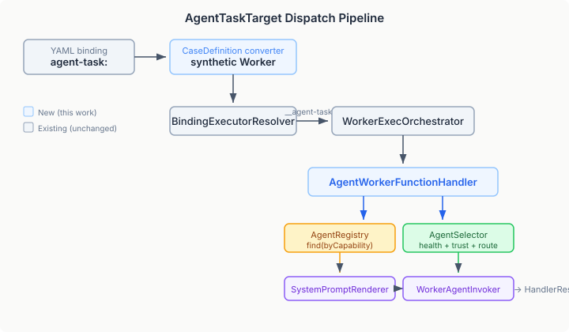

# The Dispatch That Wasn't There

The [previous entry](2026-11-22-mdp01-the-agent-that-found-its-own-slot.md) gave agents their own slot in the worker SPI: YAML declares an agent by slot name, and the handler resolves it at execution time through `AgentRegistry`. That works when you know which agent you want. But what if you don't?

A case binding that says "run the agent with the `risk-assessment` capability in the `aml` domain" doesn't name a specific agent. It describes a need. The platform should find the right agent, check it's healthy, consider trust scores, and invoke it — the same selection pipeline that every other dispatch path uses. That's what `AgentTaskTarget` was wired into the `BindingTarget` hierarchy to do. But wiring the type is the easy half. The other half — the runtime dispatch — was a stub: `ExecutorRef.of(at.capability())`. A name with nothing behind it.

## The pipeline gap

CaseHub's execution pipeline has a strict contract: binding → `ExecutorRef` → worker lookup by name → handler dispatch. For `CapabilityTarget`, this works because there's a registered worker declaring that capability. For `AgentTaskTarget`, there is no worker. The agent lives in the `AgentRegistry`, not in the case definition's worker list. The pipeline looks for a worker by name, finds nothing, and fails with "Worker not found."

Three options presented themselves. We could intercept at the `WorkerExecutionOrchestrator` level and bypass the worker lookup entirely — but that changes the core pipeline's contract for one target type. We could create a new SPI layer for binding-level dispatch — but the existing handler SPI already does the job. Or we could make the pipeline work as-is by creating a synthetic worker at definition load time, so by the time dispatch runs, the worker exists.



## Synthetic workers

The synthetic approach means every `AgentTaskTarget` binding gets a corresponding worker, created during case definition conversion. The worker carries a `CapabilityConfig` with the capability name, domain, model override, and expression evaluators for input/output mapping. At dispatch time, `BindingExecutorResolver` resolves the binding to `__agent-task__<bindingName>`, the pipeline finds the synthetic worker, and `AgentWorkerFunctionHandler` takes it from there.

The interesting consequence: the execution pipeline sees no difference between a slot-based agent worker and a capability-based one. Both are deferred — resolved at runtime from the `AgentRegistry`. The difference is in what they query (slot vs capability+domain) and how they select (direct lookup vs platform selection pipeline).

## From `AgentSlotConfig` to sealed `DeferredAgentConfig`

The original slot-based path used `AgentSlotConfig` — a record with a slot name and optional overrides. Adding capability fields to it would have produced a 10-field record with mutual exclusion invariants: exactly one of `slot` or `capability` must be non-null, and half the fields are always null depending on which path you're on. That's a naming lie and a type smell.

Claude's decision review caught this. The reviewer pointed out that `BindingTarget` itself — the type hierarchy we're extending — uses sealed interfaces with pattern matching. That's the platform's idiom for discriminated dispatch. So `AgentSlotConfig` became a sealed `DeferredAgentConfig`:

```java
public sealed interface DeferredAgentConfig
    permits SlotConfig, CapabilityConfig {

  record SlotConfig(String slot, String model,
      String userMessageTemplate,
      String inputProjection, String outputProjection)
      implements DeferredAgentConfig { }

  record CapabilityConfig(String capability, String domain,
      String model, ExpressionEvaluator inputEvaluator,
      ExpressionEvaluator outputEvaluator)
      implements DeferredAgentConfig { }
}
```

Each subtype carries only its own fields. The handler pattern-matches, and the compiler enforces exhaustiveness. `AgentWorkerFunction` changes from `slotConfig()` to `deferredConfig()`, and the execute method becomes a switch:

```java
return switch (agent.deferredConfig()) {
  case SlotConfig sc  -> executeBySlot(sc, worker, inputData, metadata);
  case CapabilityConfig cc -> executeByCapability(cc, worker, inputData, metadata);
};
```

## Composing with the selection pipeline

The decision review's sharpest finding was about match selection. I'd planned a `matchStrategy` string field on `AgentTaskTarget` — `"first"`, `"best-domain"`, `"round-robin"` — interpreted by a switch in the handler. The reviewer traced the codebase and found the platform already has a layered selection architecture: `AgentRegistry.find()` returns OWLS-MX-ordered matches, `EngineAwareAgentSelector` applies health probing and trust scoring, and `AgentRoutingStrategy` (CDI-extensible, with `LeastLoaded`, `TrustWeighted`, and `Semantic` implementations) handles the final selection. `DefaultWorkOrchestrator` uses this pipeline. My `matchStrategy` switch would have created a parallel selection path that bypassed all of it.

The fix was to drop `matchStrategy` entirely and delegate to `AgentSelector`:

```java
var selection = agentSelector.select(matches,
    SelectionContext.of(tenancyId, config.capability(), config.domain()));

return switch (selection) {
  case Selected sel    -> buildAndInvoke(sel.agent(), config, worker, inputData);
  case NoneQualified nq -> new HandlerResult(WorkerResult.failed(nq.reason()));
  case Escalated esc   -> new HandlerResult(WorkerResult.failed("Escalated: " + esc.reason()));
};
```

Capability-based dispatch now gets health probing, trust-weighted routing, and semantic re-ranking for free — the same quality as every other dispatch path.

## What this opens up

The binding surface for agents is now complete. YAML can target agents two ways: by slot (you know which agent) or by capability (you describe the need). Slot-based dispatch does a direct registry lookup. Capability-based dispatch queries by capability+domain, selects through the platform's trust-informed routing pipeline, and resolves the system prompt at execution time.

The YAML parser for `agent-task:` binding targets (#1338) is next — it creates the `AgentTaskTarget` from YAML and triggers synthetic worker creation. After that, case definitions can declare bindings that discover agents dynamically, and the platform's routing infrastructure decides which one runs.

The implicit decision here is that agent selection isn't a binding-level concern. A binding says what capability is needed; the platform decides which agent fulfils it. That separation means selection quality improves globally — a better `AgentRoutingStrategy` benefits every capability-based binding without changing any YAML.
