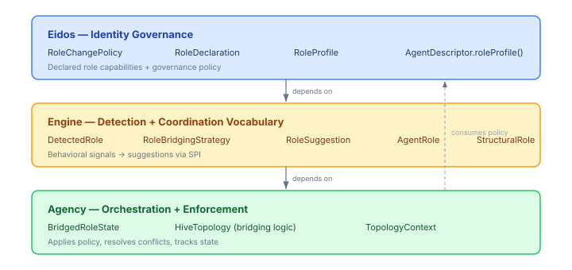

# Roles Belong with Identity

We had `RoleBridgingPolicy` sitting in agency's orchestration package. It controlled whether detected behavioral patterns could promote or demote an agent's declared coordination role — advisory only, auto-apply above a confidence threshold, or fully automatic. The topology consumed it. The topology is in agency. So the policy was in agency. Seemed obvious.

It was wrong.

## The capability parallel that changes everything

Eidos already solved the same structural problem for capabilities. An agent declares what it can do (`AgentCapability` on `AgentDescriptor`). At dispatch time, `CapabilityHealth` probes whether the capability is actually available right now — checking degradation state, behavioral signals, epistemic fitness. The declared identity is in eidos. The runtime probe is in eidos. The enforcement — routing decisions, dispatch gating — happens in engine and agency.

Roles have exactly the same declared-vs-operable duality. An agent can serve as coordinator. That's an identity fact — it doesn't change per topology instance. Whether the agent IS the coordinator in this specific case execution is coordination state. And the policy controlling when behavioral evidence can change that assignment? That's identity governance. Same layer as capability health thresholds.

The table makes it concrete:

| Dimension | Capability | Role |
|---|---|---|
| **Declared** (identity) | `AgentCapability` — "I can do X" | `RoleDeclaration` — "I can serve as coordinator" |
| **Runtime** (coordination) | `CapabilityHealth.probe()` | `AgentRole` assignment in topology |
| **Behavioral signal** | `BehavioralSignal` (DECLINE, VIOLATED) | `DetectedRole` from stigmergy |
| **Governance** | Probe thresholds, signal TTLs | `RoleChangePolicy` (mode, confidence, hysteresis) |

Once I saw this table, the placement was obvious. Governance rules live with the identity layer, not with the enforcement layer. `AutonomyBudgetPolicy` was promoted from agency to platform-agent-api for the same reason — a policy consumed by agency but governed at a lower tier.

## What moved where

Three types went into `eidos-api`:

**`RoleChangePolicy`** — the renamed governance record. Three modes (advisory, auto-above-threshold, automatic), confidence thresholds for promotion and demotion, hysteresis via hold cycles. Pure data, no external dependencies. The name dropped "bridging" — this isn't about bridging two concepts, it's about governing when role changes are allowed.

**`RoleDeclaration`** — a declared role an agent can serve, with optional vocabulary grounding. Parallels `AgentCapability` with its capability name and vocabulary URI.

**`RoleProfile`** — the composition root on `AgentDescriptor`. Bundles declared role capabilities with the change policy. Same shape as how capabilities are listed alongside their health configuration.

What stayed in agency: `BridgedRoleState` — per-agent tracking of which roles have been bridged, their current confidence, and accumulated hold cycles. That's orchestration runtime state, not identity governance. `HiveTopology` still runs the enforcement logic. It just imports the governance types from eidos instead of owning them.

## The naming conversation

I initially called it `RoleEvolutionPolicy`. Wrong. "Evolution" in this platform has a specific meaning — improvement-directed change. Disposition evolution means the personality profile is advancing toward a better fit. Role change isn't about improvement. It's about governance: when is the system allowed to reassign roles based on behavioral evidence?

We went through several alternatives — adaptation, management, supervision — before landing on `RoleChangePolicy`. It says what it does. No metaphor to decode, no collision with existing terms.

## Why this matters beyond naming

The move establishes a pattern: eidos owns the identity governance layer for agents. Capabilities, disposition, and now roles — each has declared state on the descriptor and governance rules controlling how that state can change. Agency enforces within those bounds. Engine detects and suggests.

This three-layer architecture — eidos governs, engine detects, agency enforces — means a new dimension of agent identity can follow the same path without reinventing the governance model. The declared-vs-operable duality is the structural template.

What's not built yet: `RoleHealth` — the probe equivalent that parallels `CapabilityHealth` for roles. Right now, the topology consults the policy directly. A proper health layer would let any consumer ask "can this agent serve as coordinator right now?" and get back a verdict informed by behavioral signals, declared capabilities, and governance policy. That's the next piece of the puzzle.
