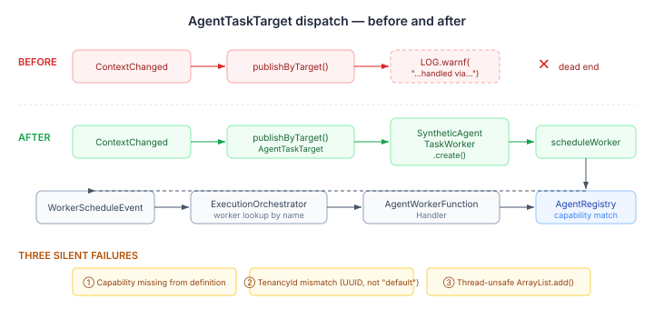

# The Last Fifteen Lines

[The previous entry](2026-11-22-mdp02-the-dispatch-that-wasnt-there.md) built the machinery: `SyntheticAgentTaskWorker`, the sealed `DeferredAgentConfig`, the capability-based resolution path in `AgentWorkerFunctionHandler`. What it didn't do — and I didn't realise until I wrote the integration test — was connect the machinery to the event that triggers it.

`CaseContextChangedEventHandler.publishByTarget()` has a switch over `BindingTarget` subtypes. `CapabilityTarget` dispatches through the full routing pipeline. `SubCaseTarget` publishes a sub-case schedule. `JudgmentTarget` goes through the judgment pipeline. `AgentTaskTarget`? It logged a warning and returned.

```java
case AgentTaskTarget ignored ->
    LOG.warnf("AgentTaskTarget dispatch on binding '%s'"
        + " — handled via synthetic worker", binding.getName());
```

The comment said "handled via synthetic worker." Nothing handled it. The synthetic worker existed in the type system but was never created at runtime.

## What the test found

I asked Claude to explore the dispatch pipeline before writing the test. The exploration traced every call site for `SyntheticAgentTaskWorker.create()` and found it was only called in unit tests — never in production code. The event handler's `AgentTaskTarget` arm was a placeholder. The `BindingExecutorResolver` correctly resolved to `__agent-task__<bindingName>`, but the worker with that name didn't exist in the case definition, so the orchestrator failed with "Worker not found" and silently retried until exhaustion.

The fix was fifteen lines. Create the synthetic worker, add it to the definition's workers list (so the orchestrator can find it), and call `scheduleWorker`:

```java
case AgentTaskTarget at -> {
  Worker syntheticWorker =
      SyntheticAgentTaskWorker.create(binding.getName(), at);
  List<Worker> defWorkers = caseDefinition.getWorkers();
  synchronized (defWorkers) {
    if (defWorkers.stream()
            .noneMatch(w -> w.name().equals(syntheticWorker.name()))) {
      defWorkers.add(syntheticWorker);
    }
  }
  scheduleWorker(caseInstance, defWorkers, binding,
      Capability.of(at.capability(), ".", "."),
      syntheticWorker.name(), signalId, experiences, activationSnapshot);
}
```



## Three things that failed silently

The test didn't pass on the first run. It didn't pass on the second either. Each failure produced the same symptom — case stuck in `RUNNING`, context unchanged from initial state — but for different reasons.

**Missing Capability in definition.** The `WorkerExecutionOrchestrator` looks up the worker by name (found it, after I added the synthetic worker), then looks up the `Capability` by name from `definition.getCapabilities()`. I hadn't added one. No capability → "Capability not found" → retry → exhaustion. The fix: `definition.getCapabilities().add(Capability.of(capabilityName, ".", "."))`.

**TenancyId mismatch.** I registered the agent descriptor with `tenancyId("default")`. The case instance's tenancyId comes from `DefaultTestPrincipal`, which returns `TenancyConstants.DEFAULT_TENANT_ID` — a UUID (`278776f9-...`), not the string `"default"`. The agent registry query matched on capability name but filtered on tenancyId. Zero matches → `NoneQualified` → "No candidates available" → retry → exhaustion.

**Thread-unsafe list mutation.** Claude's code review caught this one. When multiple bindings are selected, `publishByTarget` runs in parallel via `CompletableFuture`. Two `AgentTaskTarget` bindings on the same definition would concurrently `stream()` and `add()` on the same `ArrayList`. The `synchronized` block in the fix above prevents `ConcurrentModificationException`.

All three failures were silent. The case stayed `RUNNING`. No exception surfaced at INFO level. The retry orchestrator absorbed the failures and rescheduled. Without the debug diagnostic output — `_diagnostics` in the case context — I'd have been guessing.

## The diagnostic trail

The breakthrough was printing `instance.getCaseContext().getData()` in the awaitility loop. The first real clue:

```
{text=Hello world, status=pending, _diagnostics={analyze-binding={
  status=FAILED, attempts=1,
  history=[{agent=__agent-task__analyze-binding,
            status=FAILED,
            reason=No candidates available, ...}]}}}
```

"No candidates available" pointed directly at the agent registry query returning empty. From there, the tenancyId mismatch was a targeted search.

The pattern here — an execution pipeline that absorbs errors and surfaces them only through side-channel diagnostics — is deliberate in CaseHub. Workers fail. Agents are unavailable. The pipeline retries, reroutes, and eventually escalates. That's the right production behaviour. But it makes integration tests harder to debug. A test that expects `COMPLETED` and gets `RUNNING` with no visible exception has to know where to look.

## What this completes

The agent-task dispatch path is now end-to-end. A binding with an `AgentTaskTarget` fires, the event handler creates the synthetic worker on the fly, and the execution pipeline runs it through the same `AgentWorkerFunctionHandler` that handles slot-based dispatch. The integration test verifies the full chain: binding trigger → synthetic worker → capability resolution → agent invocation → output merged into context → goal met → case `COMPLETED`.

The `SchedulerService` has the same placeholder for schedule-triggered `AgentTaskTarget` bindings. That's a separate fix — cron and delay triggers go through a different dispatch path, but the synthetic worker creation is identical.
