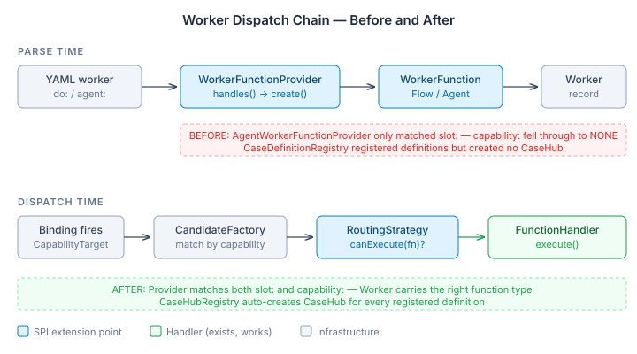

# Closing the Last Three Gaps

Workers with `do:` blocks and `agent:` blocks could be defined in YAML, but they couldn't dispatch. The parse-time providers created the right function objects — `FlowWorkerFunction`, `AgentWorkerFunction` — and the execution-time handlers existed to run them. But at dispatch time, the engine threw "No backend supports capability." Three issues, same root pattern: the SPI wiring was incomplete.



The first gap turned out to be a non-gap. `FlowWorkerFunctionProvider` was CDI-managed via `FlowBeans`, the handler was discovered, and `CaseDefinitionYamlMapper.load()` correctly stored the function on the `Worker` record. The diagnostic test proved the chain end-to-end. The real issue is downstream — in deployment configurations where the `flow` module isn't on the classpath. The engine's wiring is correct; what's missing is the dependency in consuming apps.

The second gap was a coverage hole. `AgentWorkerFunctionProvider` only matched `agent: { slot: ... }` — the `handles()` method required both `has("agent")` and `has("slot")`. Workers with `agent: { capability: text-classification }` fell through to `WorkerFunction.NONE`. The handler already supported capability-based dispatch via `DeferredAgentConfig.CapabilityConfig` and the sealed `switch` in `executeByCapability()`. The fix was widening the provider to match and create for both variants.

The third gap is about boilerplate elimination. `CaseYamlRegistrar` registered definitions into the `CaseDefinitionRegistry`, but the runtime API — `startCase()`, `signal()`, `query()` — required a `CaseHub` bean. Every YAML-defined case needed an explicit Java class:

```java
@ApplicationScoped
public class HelpdeskCaseHub extends YamlCaseHub {
  public HelpdeskCaseHub() { super("casehub/helpdesk.yaml"); }
}
```

The fix is a `CaseHubRegistry` wired into `DefaultCaseDefinitionRegistry.registerCaseDefinition()`. When a definition is registered and no explicit `CaseHub` bean exists for it, the registry auto-creates one. This works for all registration paths — YAML, annotations, programmatic — not just the YAML registrar. A new protected constructor on `CaseHub` accepting `CaseHubRuntime` enables the non-CDI-managed instances.

What this unblocks: `casehubio/examples#212` can drop its explicit `HelpdeskYamlCaseHub` subclass. A YAML file in `casehub/` is enough — workers with `do:` or `agent:` blocks dispatch, and the case runtime API is available via `CaseHubRegistry.get("helpdesk-ticket")`.
