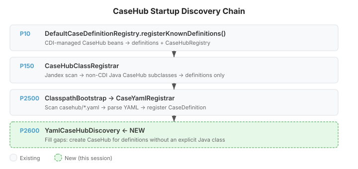
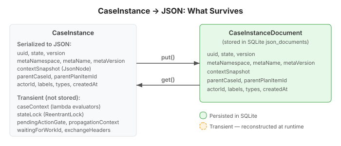

# Removing the Java Tax from CaseHub Apps

A zero-Java case application needs two things the engine didn't provide: automatic CaseHub creation from YAML definitions, and persistence without Hibernate. We built both today.

## The Discovery Gap

The engine already scanned `casehub/*.yaml` on the classpath and registered `CaseDefinition` objects at startup. What it didn't do was create `CaseHub` instances for those definitions. Without a `CaseHub`, you couldn't start cases, send signals, or query state — the YAML was parsed but inert.

The fix lives in a four-stage startup chain, each stage at a different CDI priority so explicit Java classes always take precedence over YAML-discovered ones:

`YamlCaseHubDiscovery` runs last, at priority 2600. It iterates every registered `CaseDefinition`, checks whether a `CaseHub` already exists for it (from an earlier stage), and fills the gap if not. The logic is twelve lines of code — the interesting part was where to put them.

The issue specified `engine/flow`, but `flow` depends only on `engine-common` — it can't see `CaseHubRegistry`, which lives in `runtime`. We put it in `runtime/bootstrap/` alongside the existing registrars. Same process, same module, same startup observer pattern. The module boundary settled the question.

## Persistence Without Hibernate

The second piece was a new `persistence-json` module implementing `CaseInstanceCache` backed by Pages' `JsonCollectionStore`. Four methods — `put`, `get`, `clear`, `getAll` — bridging the case engine's SPI to SQLite JSON collections.

The design question was serialization. `CaseInstance` carries runtime-only state that can't survive a JSON round-trip: a `ReentrantLock` for concurrent state transitions, `CaseContext` with lambda-based expression evaluators, and `PropagationContext` for in-flight execution. Serializing the full object graph would be fragile and version-coupled.

We serialize a flat `CaseInstanceDocument` record — the UUID, state, version, case metadata coordinates, context snapshot, and scalar fields. On retrieval, we look up `CaseMetaModel` from `CaseDefinitionRegistry` using the stored namespace/name/version. The engine reconstructs the full `CaseContext` from the snapshot when it needs it — the same path the Hibernate persistence already uses.

The trade-off is explicit: transient state like `pendingActionGate` and `waitingForWorkId` is lost on restart. For a zero-Java helpdesk app, that's acceptable. A case that was mid-execution when the process stopped will resume from its last persisted state, not from an in-memory lock.

## What This Opens Up

A developer can now drop a YAML file in `casehub/` on the classpath and get a fully functional case application — cases start, workers execute, state persists to SQLite — without writing a single line of Java. The remaining pieces in the queue are the agent function provider (eidos) and the helpdesk example itself.
