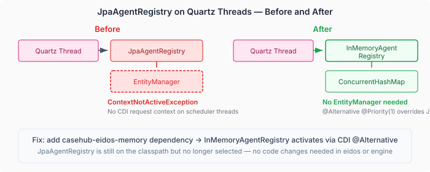
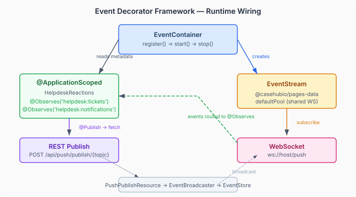

# CDI on Scheduler Threads, and Decorators for the Browser

The YAML helpdesk lifecycle test existed but had never passed. The agent worker function tried to look up an eidos agent descriptor on a scheduler thread, hit `JpaAgentRegistry`, and died with a `ContextNotActiveException` — no CDI request context, no EntityManager session, no recovery.

## The Scheduler-Thread Problem

The engine's scheduler is pluggable — `JobScheduler` and `WorkerExecutionManager` are SPIs in `common-core`, with both a Quartz backend and a db-scheduler backend. The db-scheduler implementation is `@Priority(10)` to Quartz's `@Priority(0)`, so it's actually the default when both are on the classpath. Both backends delegate to shared orchestrators (`WorkerExecutionOrchestrator`, `RetryOrchestrator`, etc.) that hold all the domain logic. The problem here isn't Quartz-specific — it's any background thread that lacks a CDI request context.

The error message was deceptive. It said "Cannot use the EntityManager/Session" and pointed at the worker execution orchestrator. We initially suspected the ledger event captures — they're the usual suspects for EntityManager access on background threads, and the engine's own test modules all exclude them. We added the same exclusions. Same error.

The stack trace told the real story. `AgentWorkerFunctionHandler.executeBySlot()` calls `JpaAgentRegistry.find()`, which calls `Session.createQuery()`. The JPA registry is `@ApplicationScoped` and auto-activated by `@IfBuildProperty` — it's the default when the reactive variant isn't enabled. On a request thread, the EntityManager proxy works fine. On a scheduler thread — whether from Quartz's thread pool or db-scheduler's polling executor — there's no request context to activate the proxy.



The fix was a dependency, not a code change. `casehub-eidos-memory` provides `InMemoryAgentRegistry`, annotated `@Alternative @Priority(1)`. Drop it on the classpath and CDI selects the in-memory variant — no EntityManager, no request context requirement, no scheduler-thread problem. The JPA registry stays on the classpath but is never selected.

This is the CDI priority chain working as designed, but it's the kind of problem that burns an hour if you start from the error message instead of the stack trace. The orchestrator only logged `cause=` with `e.getMessage()` — no stack trace. We had to temporarily add the exception object to the log call, rebuild common-core, run the test, and read the full chain to find `JpaAgentRegistry.find()` twelve frames down.

## Decorators for Push Topics

The second half of the session built something new: `@casehubio/pages-event-decorators`, a TypeScript package that brings CDI-inspired annotations to the browser.

```typescript
@ApplicationScoped
class HelpdeskReactions {
  @Observes('helpdesk:tickets')
  onTicketClassified(event: TicketEvent) {
    if (event.type === 'CLASSIFIED') {
      console.log(`Ticket classified: ${event.category}`);
    }
  }
}
```

Three decorators — `@ApplicationScoped`, `@Observes`, `@Publish` — stored as Symbol properties on the class prototype. `EventContainer` reads the metadata, instantiates singletons, subscribes to push topics via the existing `EventStream` pool from `pages-data`, and routes incoming events to the matching methods. `@Publish` wraps a method so its return value is POSTed to the push REST endpoint.



The design deliberately reuses existing infrastructure. `EventStream` from `pages-data` handles WebSocket connection pooling, reconnect, and cursor tracking. `PushPublishResource` in `pages-push-runtime` handles the REST publish side. The decorator package adds a metadata layer and a container — it doesn't duplicate transport.

No `reflect-metadata` polyfill. The pages monorepo has `experimentalDecorators: true` in its shared tsconfig but doesn't set `emitDecoratorMetadata`. Symbol properties are the simplest metadata mechanism that survives prototype chains without polyfills.

## The YAML / TS Equivalence

The point of the decorator framework isn't to replace YAML bindings — the engine evaluates those server-side. It's to give TypeScript applications the same declarative event-driven model for their own client-side reactions. A YAML binding watches for context changes and fires a capability; a `@Observes` method watches a push topic and runs application logic. Same paradigm, different execution context.

The helpdesk example makes this concrete: `helpdesk-reactions.ts` logs ticket classification and resolution events. It's thirty lines of code that would otherwise be scattered across Lit component lifecycle methods, manually creating `EventStreamController` instances and wiring callbacks. The container handles all of that.
